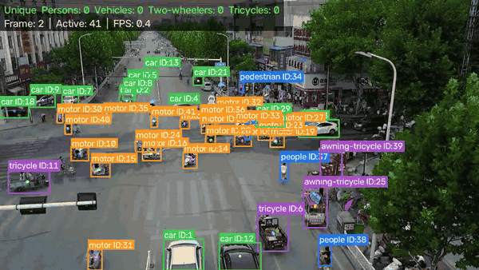
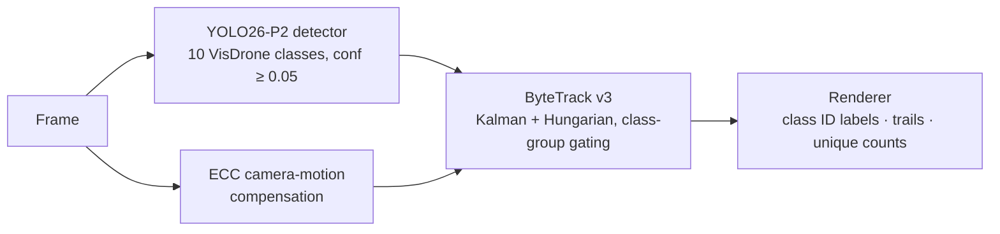

# The Aerial Guardian

Multi-object tracking for drone footage: a YOLO26-P2 detector for the ten VisDrone classes, a ByteTrack
written from scratch, and camera-motion compensation, with a live demo that runs entirely in your browser.



**Live demo:** [halok600.github.io/The-Aerial-Guardian](https://halok600.github.io/The-Aerial-Guardian/), no inference
server, no upload, no sign-up.

## Highlights

- **10-class drone detection with a P2 head.** An extra stride-4 detection level for small targets (the median person in DET-val is
  about 12 px wide and 25 px tall), on YOLO26 (pedestrian, people, bicycle, car, van, truck, tricycle, awning-tricycle, bus, motor).
- **ByteTrack written from scratch**, with tentative tracks (after the first frame, a one-frame false positive never gets an ID), class-group
  gating (a person can never take over a car's ID), majority-vote class labels and duplicate removal.
- **Camera-motion compensation.** OpenCV ECC estimates how the drone moved between frames and every Kalman prediction is
  moved with it. On MOT-test-dev it cuts person ID switches from 1,443 to 577 and vehicle ID switches from 1,046 to 181.
- **Runs in the browser, no inference server.** A YOLO26n-P2 ONNX model on ONNX Runtime Web (WebGPU, falling back to WASM), a
  JavaScript port of the tracker tested against the Python one, and a translation-only motion estimator.

## Results

### Detection (VisDrone2019-DET-val)

| Model | Person recall @0.25 | Person precision @0.25 | mAP50 (10 cls) | mAP50-95 |
|---|---|---|---|---|
| v1 YOLOv8n-P2 (person only) | 2.8% | 55.7% | n/a | n/a |
| v2 YOLO26n-P2 @960 (browser demo) | 48.8% | 73.5% | 0.429 | 0.246 |
| v2 YOLO26s-P2 @1280 (offline renders, tracking eval) | 62.5% | 79.0% | 0.536 | 0.324 |

| Class | AP50, n @960 | AP50, s @1280 |
|---|---|---|
| pedestrian | 0.520 | 0.661 |
| people | 0.406 | 0.519 |
| bicycle | 0.145 | 0.297 |
| car | 0.837 | 0.880 |
| van | 0.471 | 0.562 |
| truck | 0.377 | 0.477 |
| tricycle | 0.299 | 0.436 |
| awning-tricycle | 0.155 | 0.216 |
| bus | 0.584 | 0.694 |
| motor | 0.495 | 0.621 |

The v1 model has one class and v2 has ten, so their mAPs are not comparable; both are scored on the same person
yardstick instead: on the 548 DET-val images, person predictions at confidence 0.25 are matched one-to-one to the 13,969
pedestrian + people ground-truth boxes at IoU 0.5, after dropping predictions that lie mostly (IoA > 0.5) inside a VisDrone
ignored region. mAP and per-class AP50 come from Ultralytics `val` with its default settings except `imgsz` and `max_det=1000` (so its NMS IoU is Ultralytics' default 0.7, not the 0.6 of the tracking pipeline).¹

**Both v2 models are under-trained.** Each had a 9.5 h training budget on a Kaggle T4 GPU. `epochs=300` was only an upper
bound: Ultralytics' `time=` budget recomputes the epoch count so the cosine learning-rate schedule finishes in time, which
ended the n model at 50 epochs and the s model at 24. More GPU time is the obvious next lever.

¹ One physical person can produce both a "pedestrian" and a "people" box from the 10-class model; the second counts as a
false positive, so v2 person precision is slightly pessimistic.

Full tables: [s @1280](docs/results/det_s1280.md), [n @960](docs/results/det_n960.md).

### Tracking (VisDrone2019-MOT-test-dev, 17 sequences)

All four rows use the same detections (YOLO26s-P2 @1280, confidence floor 0.05). The second row runs Ultralytics'
ByteTrack with my thresholds, so the difference between it and my tracker is the tracker code, not the tuning.

**Person** (pedestrian + people)

| Tracker | HOTA | MOTA | IDF1 | ID switches |
|---|---|---|---|---|
| Ultralytics ByteTrack (default config) | 34.3 | 11.1 | 41.4 | 2482 |
| Ultralytics ByteTrack (our thresholds) | 35.8 | 27.9 | 45.5 | 1636 |
| Ours (no camera-motion comp.) | 36.1 | 28.2 | 45.9 | 1443 |
| Ours + ECC camera-motion comp. | 40.2 | 28.8 | 52.4 | 577 |

**Vehicle** (car + van + truck + bus)

| Tracker | HOTA | MOTA | IDF1 | ID switches |
|---|---|---|---|---|
| Ultralytics ByteTrack (default config) | 53.8 | 56.2 | 66.7 | 1273 |
| Ultralytics ByteTrack (our thresholds) | 55.9 | 65.5 | 70.0 | 1121 |
| Ours (no camera-motion comp.) | 56.2 | 66.0 | 70.5 | 1046 |
| Ours + ECC camera-motion comp. | 61.7 | 68.1 | 80.4 | 181 |

**Protocol.** Tracker thresholds were tuned on MOT-val and are reported on MOT-test-dev; the tracker was never tuned on
test-dev (the 33-sequence test-challenge split has no public ground truth). Two groups are scored, each as its own
TrackEval benchmark: person = pedestrian + people, vehicle = car + van + truck + bus. Bicycles, motors and the two
tricycle classes are tracked and drawn but not scored. Ground-truth boxes **and** predictions inside VisDrone ignored
regions (IoA > 0.5) are both dropped, so feeding the ground truth back in scores exactly 100. Scores are TrackEval's
sequence-combined numbers ([copy of the tables](docs/results/mot_table.md)).

**How to read it.**

- Most of the gain comes from camera-motion compensation. Without it, my tracker is roughly on par with Ultralytics'
  ByteTrack given the same thresholds (person HOTA 36.1 vs 35.8, vehicle 56.2 vs 55.9).
- Tuning: 96 threshold variants on MOT-val, the winner chosen by the mean of person and vehicle HOTA. Every one of the
  top 33 variants sits on the grid edge `new_track` = 0.6, so a wider grid might do better, and the top variants are
  practically tied (52.24 for the winner, 52.20 for the next two). [Tuning table](docs/results/mot_tuning.md).
- Results vary by sequence and a few are worse than the baseline: person HOTA on `uav0000161_00000_v` is 25.2 with ECC
  against 32.2 for Ultralytics' default config, and vehicle HOTA on `uav0000073_00600_v` is 0.0 for every row that uses
  my thresholds (Ultralytics' default config gets 38.4). That sequence has only 13 vehicle ground-truth boxes in total, so the
  0.0 is a tiny-sample effect with negligible weight in the pooled numbers; person HOTA on `uav0000188_00000_v` is also
  slightly lower with ECC (17.5 against 18.2). Since Ultralytics' tracker with my thresholds also scores 0.0 on
  `uav0000073_00600_v`, the thresholds look like the cause rather than the tracker code, but I have not investigated it.
  [Per-sequence HOTA](docs/results/mot_per_seq.md).

## Pipeline



The detector runs at a low confidence floor on purpose: ByteTrack's second stage uses weak boxes to keep existing tracks
alive, and only boxes scoring at least `new_track` (0.6) can start a track. All thresholds live in
[configs/tracker.yaml](configs/tracker.yaml). The design, with the reasoning behind each choice, is in
[docs/ARCHITECTURE.md](docs/ARCHITECTURE.md).

| | Python pipeline | Browser demo |
|---|---|---|
| Detector | YOLO26s-P2 @1280, one-to-many head + NMS (IoU 0.6) | YOLO26n-P2 @960, the one-to-one NMS-free head exported from the n checkpoint (whose DET-val numbers above use the one-to-many head + NMS) |
| Camera motion | OpenCV ECC (Euclidean, 3-level pyramid) | Translation-only shift on a 160 px thumbnail |
| Tracker | [src/tracker/](src/tracker/) | [web/js/tracker.js](web/js/tracker.js), checked against fixtures from the Python tracker |

## What changed in v2 (and why)

v1 detected people poorly, and the cause was mostly not the tracker. Re-scored with the yardstick above, the v1 model finds
2.8% of persons on DET-val. These are the causes I found or suspect, and what replaced them:

| v1 problem | v2 fix |
|---|---|
| **Probably trained from scratch by mistake.** As far as I can tell from reading the Ultralytics 8.0.x source, `YOLO("model.yaml").train(pretrained=True)` loads no weights: weights are only passed on when the model came from a `.pt`. I did not reproduce the v1 run or re-check this on the current Ultralytics. The run converged to something detector-shaped and nothing looked broken. | The notebook builds the P2 architecture, loads the YOLO26 checkpoint and **asserts that the backbone transferred** before spending GPU time. The n training run logged `290/757 tensors (38%); backbone 200/200`; the P2 branch and the 10-class output layers have no counterpart in the 80-class donor. |
| **Tiny data.** 1,978 frames from 6 sequences of the VisDrone-MOT *val* split. | VisDrone2019-DET-train (6,471 images) plus every 5th frame of the 56 VisDrone2019-MOT-train sequences. DET-val and MOT-test-dev are never trained on. |
| **Person-only, with "people" dropped.** Seated or riding people (VisDrone's "people" class) were left unlabelled, so the model learned to call them background. | All ten classes are kept, and ignored regions are greyed out in training images so unlabelled objects are not taught as background. |
| **Tracker thresholds.** The first tracker compared IoU with a *cost* threshold (demanding 80% overlap), and its thresholds were never tuned. | Thresholds are tuned on MOT-val (see Results). The tracker also gained tentative tracks, box-height-scaled Kalman noise, lost tracks matched in the first stage, duplicate removal and an aspect-correct ECC rescale. |

The model also grew: nano for the browser, small at 1280 px for offline renders and evaluation.

**Measured effect.** Only v1 against v2 as a whole is measured: person recall 2.8% → 62.5% (s @1280) and 48.8% (n @960),
precision 55.7% → 79.0% and 73.5%. The detector fixes were applied together and I did not run an ablation per change. On the
tracker side the evaluation rows do isolate two things: tuned thresholds (Ultralytics default config → our thresholds,
person HOTA 34.3 → 35.8) and ECC (36.1 → 40.2).

## Quick start

Tested with Python 3.12; an NVIDIA GPU is recommended for speed.

```bash
python -m venv .venv
.venv\Scripts\activate                 # Windows; on Linux/macOS: source .venv/bin/activate
# Install the CUDA build of PyTorch for your system first (selector at https://pytorch.org/get-started/locally/)
pip install -r requirements.txt
```

The weights are not stored in the repository. Download `yolo26s-p2-visdrone.pt` (and `yolo26n-p2-visdrone.pt` if you
want the browser-size model) from the [v2.0 release](https://github.com/Halok600/The-Aerial-Guardian/releases/tag/v2.0)
into `models/weights/`, then:

```bash
python scripts/03_track.py --source path/to/video.mp4          # or a folder of frames
python scripts/03_track.py --source path/to/video.mp4 --no-cmc # without camera-motion compensation
```

The tracked video is written to `outputs/videos/<name>_tracked.mp4`. `--weights`, `--imgsz` (default 1280) and
`--tracker-config` (default `configs/tracker.yaml`) override the defaults.

## Reproduce

Install the development extras (`pip install -r requirements-dev.txt`: pytest, jupytext, Kaggle CLI, TrackEval, lap, onnxslim and an ffmpeg wheel) and set up
Kaggle API credentials.

**1. Evaluation data** (training data is downloaded inside the Kaggle notebook):

```bash
python scripts/00_download_data.py --det val
python scripts/00_download_data.py --mot-kaggle akhileswarelluru/visdrone2019-mot \
    --mot-extract VisDrone_Zips/VisDrone2019-MOT-val/VisDrone2019-MOT-val=VisDrone2019-MOT-val \
    --mot-extract VisDrone_Zips/VisDrone2019-MOT-test-dev/VisDrone2019-MOT-test-dev=VisDrone2019-MOT-test-dev
python scripts/01_build_dataset.py --split val --out datasets/visdrone10 \
    --det data/visdrone/VisDrone2019-DET-val --yaml configs/data/visdrone10.yaml
```

**2. Training on Kaggle.** The notebook [kaggle/02_train_kaggle.ipynb](kaggle/02_train_kaggle.ipynb) is generated from
[kaggle/train_notebook.py](kaggle/train_notebook.py); the code it needs is uploaded as a private Kaggle dataset.

```bash
python kaggle/push_code.py --user <kaggle-user> --new        # first time; drop --new for updates
python kaggle/build_notebook.py --user <kaggle-user> --mot-dataset akhileswarelluru/visdrone2019-mot --scale s
kaggle kernels push -p kaggle
# --scale n builds the browser model; --smoke makes a short test run first
```

The notebook saves `yolo26{n,s}-p2-visdrone.pt` to its output; copy it to `models/weights/`.

**3. Evaluation** (outputs go to `outputs/eval/`, which is not committed; copies are in [docs/results/](docs/results/)):

```bash
python scripts/04_eval_det.py --weights models/weights/yolo26s-p2-visdrone.pt --imgsz 1280 \
    --old-onnx outputs/old-model.onnx
python scripts/04_eval_det.py --weights models/weights/yolo26n-p2-visdrone.pt --imgsz 960 \
    --label "v2 YOLO26n-P2" --out outputs/eval/det_n --old-onnx ''
python scripts/05_eval_mot.py --tune --split data/visdrone/VisDrone2019-MOT-val   # MOT-val only; refuses test splits
python scripts/05_eval_mot.py                                                      # report on MOT-test-dev
```

The v1 row needs the old person-only model, which is not in the repository: extract it from the pre-v2 history with
`git show <old-commit>:web/model/aerial-guardian.onnx > outputs/old-model.onnx`. `--old-onnx` defaults to
`web/model/aerial-guardian.onnx`, which in this repository is now the v2 n model, so always pass it explicitly: the path to
the old model, or `--old-onnx ''` to skip the v1 row (as in the n command above).

**4. Browser model and showcase:**

```bash
python scripts/06_export_web.py --weights models/weights/yolo26n-p2-visdrone.pt   # -> web/model/
python scripts/07_make_showcase.py --sequence <MOT sequence dir> --name demo1 --gif
```

**Tests** (CPU only, no downloads): `python -m pytest`, and `cd web && node --test`.

## Browser demo

The page loads `web/model/aerial-guardian.onnx` (YOLO26n-P2, 960 px, end-to-end export with the NMS-free one-to-one head,
at most 300 boxes per frame) into [ONNX Runtime Web](https://onnxruntime.ai/docs/tutorials/web/), using WebGPU when the
browser offers it and WASM otherwise. Video, image and webcam frames never leave the device.

- **Tracker port.** [web/js/tracker.js](web/js/tracker.js) reimplements the Python tracker. A parity test replays fixture
  scenes produced by the Python tracker and requires identical IDs, classes, boxes (to 1e-6) and counts; the Python
  suite fails if the fixtures go stale.
- **Camera motion.** OpenCV is too large to ship for one function, so the browser estimates a whole-pixel global
  translation by a sum-of-absolute-differences search on a 160 px wide thumbnail. It handles panning but not rotation or
  zoom; it can be switched off in the page.
- **Speed.** No fixed frame rate has been benchmarked: it depends on the device and on the backend (WebGPU or WASM). The
  page shows a live FPS meter, and the tracker adapts its lost-track timeout to the measured processing rate.

Local preview (ES modules and the model fetch need HTTP, so opening the file directly does not work):

```bash
python -m http.server 8000 --directory web
# open http://localhost:8000
```

The site deploys to GitHub Pages from `web/` on every push to `main`
([.github/workflows/deploy-pages.yml](.github/workflows/deploy-pages.yml)).

## Limitations

- **Under-trained detectors** (24 and 50 epochs, see Results), so the absolute numbers are a floor, not a ceiling.
- **Browser speed is not benchmarked**; it varies with the device and backend. The browser model is the weaker n @960 and
  is capped at 300 boxes per frame, so very dense scenes lose boxes.
- **Browser camera-motion compensation is translation-only.** The ECC behind the reported numbers is Python-only. ECC costs
  roughly 6-11 ms per frame depending on resolution and machine (a quick measurement, not a committed benchmark), and
  when it does not converge it falls back to the identity, i.e. "the camera did not move".
- **The browser head is not scored separately.** Every mAP and tracking number above comes from the Python path
  (one-to-many head + NMS); the browser's one-to-one head is checked for export fidelity only.
- **Per-sequence results vary**, and some sequences are worse than the baseline (see Results).
- **VisDrone domain bias.** Everything is trained and tuned on VisDrone (Chinese cities, its altitudes and cameras).
  Other altitudes, sensors and scenes were not measured.
- **AGPL-3.0.** Ultralytics is AGPL-3.0, and the weights are trained with it from Ultralytics' pretrained checkpoints. If
  you redistribute the weights or serve them over a network, check what AGPL-3.0 requires of you.

## Credits and license

- [VisDrone](https://github.com/VisDrone/VisDrone-Dataset) dataset, AISKYEYE team, Tianjin University.
- [Ultralytics](https://github.com/ultralytics/ultralytics) YOLO26 (AGPL-3.0), used for training, evaluation and export.
- ByteTrack: Y. Zhang et al., "ByteTrack: Multi-Object Tracking by Associating Every Detection Box", ECCV 2022. The tracker
  here is a reimplementation, not their code.
- [TrackEval](https://github.com/JonathonLuiten/TrackEval) for HOTA, MOTA and IDF1.
- [ONNX Runtime Web](https://onnxruntime.ai/) for in-browser inference.

The code in this repository is released under the [MIT License](LICENSE). The trained weights are subject to the
Ultralytics AGPL-3.0 note above.
