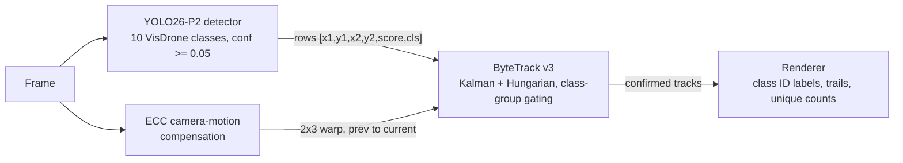
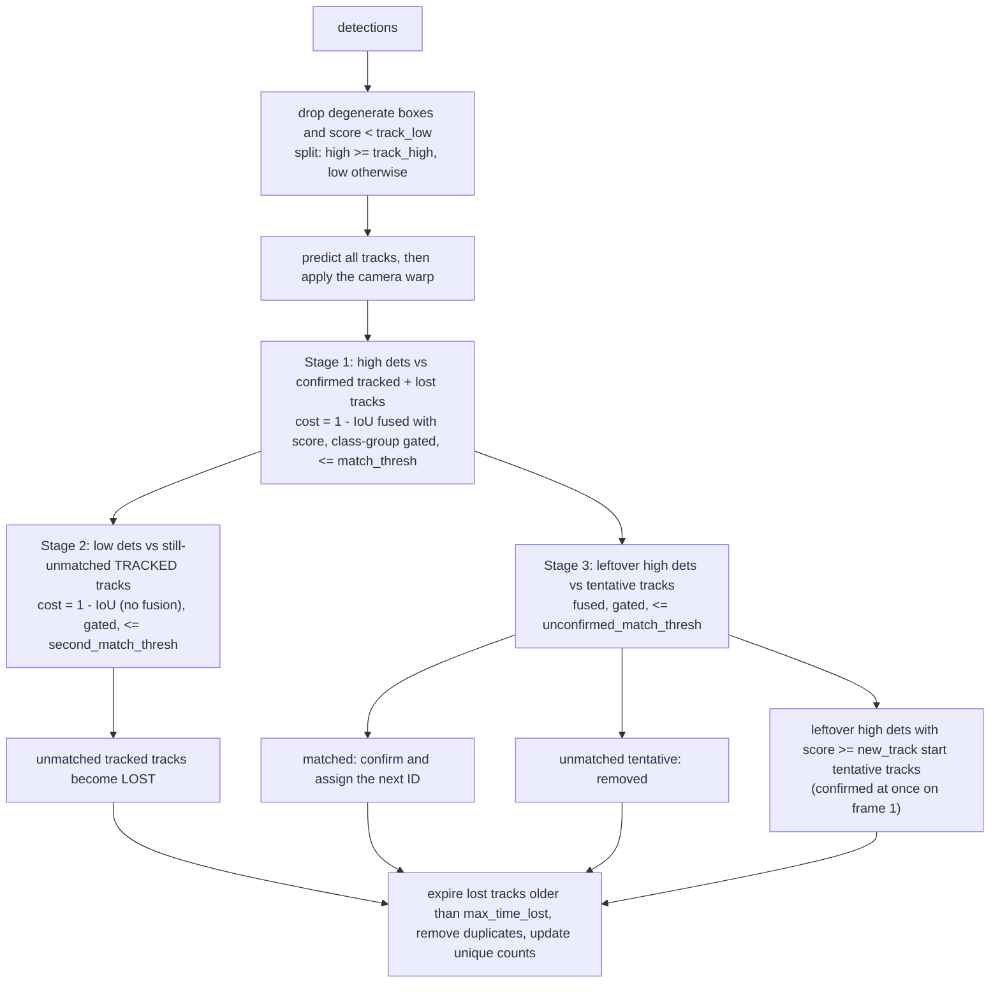
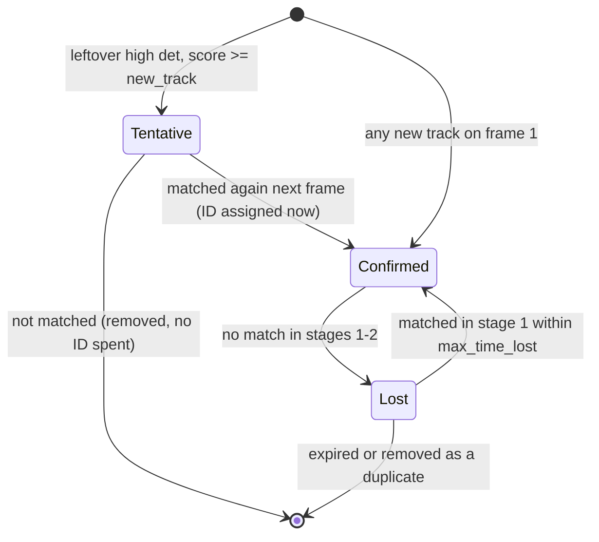

# Architecture

This document describes how The Aerial Guardian works and why it is built the way it is:
the data pipeline, the detector, the from-scratch tracker, camera-motion compensation, the
evaluation protocol, the browser port, and the mistakes we made along the way. It describes the code as it
is on this branch; where a number is quoted it is either a constant in the code (linked) or a
measurement we made, and the way it was measured is stated. Accuracy numbers for the retrained models are
not repeated here: see [README, Results](../README.md#results).

Contents: [1 Overview](#1-system-overview) · [2 Data](#2-data) · [3 Detector](#3-detector) ·
[4 Tracker](#4-tracker) · [5 Camera motion](#5-camera-motion-compensation) ·
[6 Evaluation](#6-evaluation-protocol) · [7 Browser port](#7-browser-port) ·
[8 Lessons learned](#8-lessons-learned)

---

## 1. System overview

### 1.1 Pipeline



The detector and the motion estimator read the same frame independently. Their outputs meet in
`ByteTracker.update(dets, warp)`, which is the only interface between them
([src/tracker/byte_tracker.py](../src/tracker/byte_tracker.py)). The detection array contract is the same in
Python and JavaScript: one row per box, `[x1, y1, x2, y2, score, cls]`, in original-image pixels.

### 1.2 Two runtimes

| | Python pipeline | Browser demo |
|---|---|---|
| Purpose | Evaluation, tuning, quality renders | Free, serverless, interactive demo |
| Detector | YOLO26s-P2 at 1280 px (`.pt`, fp16 on CUDA) | YOLO26n-P2 at 960 px (ONNX, ONNX Runtime Web, WebGPU then WASM) |
| Camera motion | OpenCV ECC, Euclidean model, 3-level pyramid | Translation-only SAD search on a 160 px thumbnail |
| Tracker | [src/tracker/](../src/tracker/) | [web/js/tracker.js](../web/js/tracker.js), a port checked against fixtures produced by the Python tracker |
| Entry point | [scripts/03_track.py](../scripts/03_track.py), [scripts/05_eval_mot.py](../scripts/05_eval_mot.py) | [web/index.html](../web/index.html), [web/js/app.js](../web/js/app.js) |

Both runtimes share one detector recipe (conf floor 0.05, the same ten classes) and one tracker
specification. The Python pipeline is the reference: the tracking numbers in the README come from
[src/pipeline.py](../src/pipeline.py), the same code path that renders the videos.

### 1.3 Repository map

```text
src/
  data/visdrone.py            VisDrone DET/MOT parsing, class map, ignore-region masking, YOLO label lines
  tracker/kalman_filter.py    8-state constant-velocity filter in (cx, cy, aspect, height), height-scaled noise
  tracker/matching.py         IoU / IoA, score fusion, class-group gating, Hungarian wrapper
  tracker/byte_tracker.py     ByteTrack v3: three stages, tentative tracks, votes, duplicates, unique counts
  tracker/ecc_compensator.py  ECC ego-motion estimate, aspect-preserving downscale, exact warp rescale
  pipeline.py                 Detector wrapper, run_tracking, cache_sequence / track_cached (replay for tuning)
  eval/mot_format.py          VisDrone MOT <-> MOTChallenge files, ignore-region filtering
  eval/trackeval_runner.py    TrackEval (HOTA, CLEAR, Identity), pooled and per-sequence results
  eval/det_metrics.py         Greedy recall / precision matching for the old-vs-new person comparison
  eval/onnx_person.py         Independent decoder for the v1 person-only ONNX (cross-check)
  utils/classes.py            Class names, tracker groups, colours (single source of truth)
  utils/visualizer.py         Renderer: group-coloured boxes, "car ID:12" chips, trails, HUD
  utils/video_io.py           Threaded frame prefetch and async video writer
scripts/
  00_download_data.py         Fetch DET-val, MOT-val, MOT-test-dev for local evaluation
  01_build_dataset.py         VisDrone DET + MOT -> 10-class YOLO dataset
  03_track.py                 Detect, track and render a video or frame folder
  04_eval_det.py              Detector mAP and the old-vs-new person yardstick
  05_eval_mot.py              HOTA / MOTA / IDF1, tuning grid, Ultralytics ByteTrack baselines
  06_export_web.py            ONNX export for the browser with layout detection and parity checks
  dev/make_tracker_golden.py  Golden fixtures for the JavaScript tracker
kaggle/
  train_notebook.py           Training notebook source (percent format)
  build_notebook.py           Bakes parameters into 02_train_kaggle.ipynb + kernel-metadata.json
  push_code.py                Uploads src/ and the dataset builder as a private Kaggle dataset
  notebook_helpers.py         Time budget, MOT path resolution, zip unpacking (unit-tested)
configs/tracker.yaml          All tracker thresholds
web/
  js/                         inference, tracker, kalman, matching, hungarian, cmc, frameGate, render, stats, app
  tests/                      node --test suites, including parity against the Python tracker
tests/                        pytest suite (CPU only, no dataset downloads) and fixtures
```

---

## 2. Data

### 2.1 Splits and their roles

| Split | Size | Used for |
|---|---|---|
| VisDrone2019-DET-train | 6,471 images | Training |
| VisDrone2019-MOT-train | 56 sequences, every 5th frame | Training |
| VisDrone2019-DET-val | 548 images (38,759 boxes in the 10-class conversion; 13,969 pedestrian + people) | Detector validation (mAP, person recall) |
| VisDrone2019-MOT-val | 7 sequences | Tracker threshold tuning, nothing else |
| VisDrone2019-MOT-test-dev | 17 sequences | The reported tracking numbers |

(The design notes originally said 33 sequences for test-dev; that is the test-challenge split, which has no public ground truth.
The 17 in test-dev are what the local data directory and the Kaggle dataset contain.)

Consecutive video frames are near-duplicates, so [scripts/01_build_dataset.py](../scripts/01_build_dataset.py)
keeps frames `(frame_id - 1) % 5 == 0` of each MOT-train sequence (`--mot-stride`) and adds all of DET-train for
scene diversity. The tracker is never tuned on test-dev, and the detector is never trained on DET-val or MOT-test-dev.

Only the evaluation splits live on the development laptop
([scripts/00_download_data.py](../scripts/00_download_data.py)); the training splits are downloaded inside the
Kaggle notebook. The MOT data comes from a public Kaggle dataset that stores about 34k extracted files rather than
zips, so the script downloads the whole archive once, extracts only the requested folders, and deletes it.

### 2.2 Class map

VisDrone categories 1-10 map to YOLO indices 0-9 in [src/data/visdrone.py](../src/data/visdrone.py):

| YOLO idx | 0 | 1 | 2 | 3 | 4 | 5 | 6 | 7 | 8 | 9 |
|---|---|---|---|---|---|---|---|---|---|---|
| Class | pedestrian | people | bicycle | car | van | truck | tricycle | awning-tricycle | bus | motor |

The tracker gates on four groups, defined once in [src/utils/classes.py](../src/utils/classes.py) and mirrored
in [web/js/classes.js](../web/js/classes.js): person {0, 1}, vehicle {3, 4, 5, 8}, two-wheeler {2, 9},
tricycle {6, 7}.

### 2.3 Ignored regions and why masking matters

VisDrone marks areas that annotators did not label as category 0 (ignored region) or 11 ("others"); in DET files a
`score` of 0 also means "ignore". Two things went wrong in the first version of this project:

1. The class "people" (people sitting or riding, VisDrone category 2) was dropped, with nothing covering those
   pixels. The detector was shown real people and told they were background.
2. Ignored regions were left as they were in the training image. Dense areas that the annotators
   skipped were therefore also presented as background, with real objects in them.

The builder fixes both. All ten classes are kept, and in the training split every ignore box is filled with
grey `(114, 114, 114)` (`MASK_VALUE`, the same value Ultralytics uses for letterbox padding) so the network sees
"no information" rather than "no object". Masking is applied to the train split only; val stays untouched so
mAP remains comparable with published VisDrone numbers (`mask` defaults to `split == "train"`).

Other conversion rules, all in [src/data/visdrone.py](../src/data/visdrone.py):

- Boxes are clipped to the image and dropped if either side is below 2 px after clipping (`min_size=2.0`).
- Ignore boxes and categories outside the class map produce no label line.
- Images without an ignore region are hardlinked (`os.link`, with a copy fallback), so building the dataset is
  fast and uses almost no extra disk. A masked image is re-encoded as JPEG quality 95. The destination is
  unlinked before it is written, because an earlier version wrote through a hardlink and would have overwritten the
  raw source image on a re-run.
- `--limit N` caps the samples written per source directory (the first N in sorted order; for MOT it counts after
  stride sampling, so it only covers the first sequences). The Kaggle smoke run uses it to finish in minutes.
- `--person-only` builds a single-class (pedestrian + people) variant, used to score the old person-only model.

---

## 3. Detector

### 3.1 Why a P2 head

A detector predicts on grids whose cell size is the feature stride. The default YOLO heads use strides 8, 16 and
32. A pedestrian that is 8 px wide covers about one cell of the stride-8 grid, so the network has exactly one
location from which to localise it. The P2 variant adds a stride-4 level fed by the shallow, high-resolution
backbone features (the `Concat` with backbone layer 2 in `yolo26-p2.yaml`).

At `imgsz` 1280 the stride-4 grid has 320 x 320 cells on a square letterboxed input (320 x 180 for a 16:9 rectangle);
at 960 it has 240 x 240. In the exported browser model this is visible in the output size: a raw head has
240² + 120² + 60² + 30² = 76,500 anchors, of which the P2 level contributes 57,600 (without it there would be 18,900).
An object of 8 px now covers 2 x 2 cells instead of one, and a 16 px object covers 4 x 4. Many pedestrians in
drone footage are only 8-16 px tall at the source resolution, which is the range this level is for.

The price is compute and memory: four times as many anchors, plus a high-resolution head. That cost is the
reason the model size and input size are chosen per runtime (3.4) and the reason training memory is a constraint (3.5).

### 3.2 Why YOLO26

We use Ultralytics 8.4.174 (pinned in [requirements.txt](../requirements.txt); the configs `yolo26n-p2.yaml` and
`yolo26s-p2.yaml` are referenced by name and not copied into the repo). What the installed package shows
(paths are relative to the `ultralytics` package):

- **No DFL.** `cfg/models/26/yolo26-p2.yaml` sets `reg_max: 1`, and the `Detect` head only builds a DFL layer when
  `reg_max > 1` (`nn/modules/head.py`). Box regression is a direct distance prediction, which keeps the head and
  the exported graph simpler.
- **End-to-end head.** The yaml sets `end2end: True`. The head has a one-to-many branch (used for training signal) and a
  one-to-one branch that selects its top-K rows directly, so inference needs no NMS. This is what lets the browser
  skip NMS entirely (3.7).
- **Joint training of both branches.** `E2ELoss` in `utils/loss.py` weights the one-to-many loss by 0.8 at the start
  and decays it to 0.1 over training, with the one-to-one branch taking the remainder, so the NMS-free branch is
  progressively favoured.
- **Small-box-aware assignment.** In the task-aligned assigner (`utils/tal.py`), a ground-truth box with a side
  smaller than `stride_val` is enlarged to that size when positive anchor centres are selected, so tiny objects keep
  candidate anchors. `stride_val` is the second-level stride, which is 8 px for a P2 model (strides 4, 8, 16, 32).

We do not claim anything beyond this about YOLO26 internals; the accuracy gain from the P2 level and from pretrained
weights is measured, not assumed (see README, Results).

### 3.3 Pretrained weights and the transfer check

The first version of this project trained from scratch without anyone noticing. In Ultralytics 8.0.x,
`YOLO("model.yaml").train(pretrained=True)` loads no weights: `Model.train()` hands weights to the trainer only
when the model was created from a `.pt` file, and the boolean `pretrained` is never consumed for a YAML-built
model. The run logged no error, converged to something detector-shaped, and produced an mAP50 of 0.196.

[kaggle/train_notebook.py](../kaggle/train_notebook.py) now builds the architecture from the P2 yaml and loads the
regular checkpoint into it, then proves that the load happened:

```python
model = YOLO(f"yolo26{SCALE}-p2.yaml")
before = {k: v.clone() for k, v in model.model.state_dict().items()}
model.load(f"yolo26{SCALE}.pt")
after = model.model.state_dict()
...
backbone = [k for k in keys if int(k.split(".")[1]) <= 10]      # layers 0-10 are the backbone
missing  = [k for k in backbone if k not in changed]
assert not missing, f"backbone tensors NOT transferred: {missing[:5]}"
```

Every tensor of backbone layers 0-10 must differ from its random initialisation, otherwise the notebook stops
before spending any GPU hours. The head is only partly transferred (the P2 branch and the 10-class output
layers have no counterpart in the 80-class donor), which is expected. `train()` is also given
`pretrained="yolo26{SCALE}.pt"` so the trainer's own rebuilt model loads the weights too, including on the
multi-GPU path. On the Kaggle smoke run (n scale) the check printed `backbone 200/200` tensors and
Ultralytics' own log read "Transferred 360/902 items from pretrained weights", two independent confirmations.

Limits of the check: it compares against random initialisation, so tensors that are identical across
initialisations (some normalisation statistics) cannot prove a transfer, and it asserts the backbone only. That is
why the trainer's own "Transferred N/M items" line is also read in every smoke run.

### 3.4 Two model sizes

| | n-P2, browser | s-P2, offline renders and evaluation |
|---|---|---|
| Input size | 960 | 1280 |
| Batch per step | 16 | 4 |
| Effective batch | 64 (accumulate 4) | 64 (accumulate 16) |
| Size (yaml summary at 640 px) | 2.66 M parameters, 9.5 GFLOPs | 9.77 M parameters, 27.8 GFLOPs |

n at 960 is sized to run in a browser tab; s at 1280 is the quality reference for rendered videos and for
the tracking evaluation. Both come from the same notebook, selected by `SCALE`
([kaggle/build_notebook.py](../kaggle/build_notebook.py) `--scale`).

### 3.5 Training budget and memory

Kaggle kills a session at 12 hours. [kaggle/train_notebook.py](../kaggle/train_notebook.py) therefore never asks for
a fixed epoch count. It passes `time=` to Ultralytics, which measures the first epochs and then recomputes the total
epoch count so that the cosine learning-rate schedule completes inside the budget (`epochs=300` is only an
upper bound). The budget itself comes from `compute_time_budget` in
[kaggle/notebook_helpers.py](../kaggle/notebook_helpers.py):

```text
budget = min(TIME_HOURS, SESSION_LIMIT_H - setup_hours_already_spent - RESERVE_H)
         9.5 h requested, 11.0 h session limit (12 h hard kill), 1.0 h reserved for the final
         validation, checkpoint copy and plots; the helper refuses to start if under 0.5 h remain
```

Memory on a Kaggle T4 (about 15 GB usable) is the binding constraint for the s model: at 1280 px the P2 head and dense VisDrone scenes
(the out-of-memory log showed a batch whose largest image held 198 ground-truth objects) exhaust it at batch 8. The notebook uses
batch 4 and relies on Ultralytics' nominal batch size (`nbs=64`) to accumulate gradients to an effective batch of 64
(`accumulate = round(64 / 4) = 16`), and sets `PYTORCH_CUDA_ALLOC_CONF=expandable_segments:True` before torch
is imported to reduce fragmentation. Other training settings: cosine LR, `close_mosaic=10`, `flipud=0`, `fliplr=0.5`,
`scale=0.5`, HSV jitter, `seed=42`, `save_period=5`.

### 3.6 Detector confidence is low on purpose

Everything downstream is built around a detector confidence floor of 0.05
(`DetectorSettings.conf` in [src/pipeline.py](../src/pipeline.py), `DETECTOR_CONF` in
[web/js/app.js](../web/js/app.js)). ByteTrack's second association stage exists to keep tracks alive on weak
detections (an occluded or blurred object scores low), and those boxes must reach the tracker to be used. High-precision
thresholds are applied by the tracker (`track_high`, `new_track`), not by the detector. The same floor is given to
the Ultralytics baselines in the evaluation so the comparison is fair. Other detector settings: NMS IoU 0.6
(a no-op for the NMS-free head), `max_det=1000` because dense frames exceed Ultralytics' default of 300, and fp16
on CUDA.

### 3.7 Export for the browser

[scripts/06_export_web.py](../scripts/06_export_web.py) exports static-shape ONNX (opset 17, simplified by
`onnxslim`) and writes `model-meta.json` (input size, output format, class names, source weights, Ultralytics version).

- **`nms=False` is required for the NMS-free layout.** In 8.4.174 the exporter switches the head to its one-to-one
  branch only when `nms` is exactly `False`; the default (`None`) exports the raw head. The result is `[1, 300, 6]`
  rows of `(x1, y1, x2, y2, score, cls)` in letterboxed input pixels, 300 being the exporter's top-K. A raw export is
  `[1, 4 + nc, N]` and needs NMS in the browser; the script detects which one it produced from the output shape and
  cross-checks the `end2end` entry in the ONNX metadata, so the layout recorded for the browser is never a guess.
- **The parity check compares matching heads.** After export, ONNX Runtime and the PyTorch weights are run on real images and
  compared. For `end2end`, the PyTorch side must also use the one-to-one head (`predict(nms=False)`,
  `end2end` set on the model); a freshly loaded checkpoint predicts with its one-to-many head plus NMS, and comparing
  that against the exported one-to-one graph reports differences on a perfectly good export. Rows are matched by
  class, score (tolerance 1e-4) and box (0.5 px) rather than by position, because near-tied scores reorder between
  runtimes; detection counts are compared at three confidences; `rect=False` is used on both sides because Ultralytics
  otherwise letterboxes to a minimal rectangle while the ONNX model and the browser use the full square.
- **Failures are loud.** The export aborts if the requested and detected layouts differ, if `onnxslim` is missing
  (Ultralytics would otherwise silently write an unsimplified graph), or if weights named `smoke` or `dev` are
  pointed at the committed `web/model/` directory.

---

## 4. Tracker

The tracker is a ByteTrack variant written from scratch (no Ultralytics or filterpy code):
[kalman_filter.py](../src/tracker/kalman_filter.py), [matching.py](../src/tracker/matching.py),
[byte_tracker.py](../src/tracker/byte_tracker.py). Its dependencies are numpy and scipy.

### 4.1 Motion model

State: `[cx, cy, a, h, vx, vy, va, vh]` with `a = w / h`, measurement `[cx, cy, a, h]`, constant-velocity
transition with `dt` = 1 frame. All position and velocity noise scales with the box height
(`std_weight_position = 1/20`, `std_weight_velocity = 1/160`):

| Term | Standard deviation |
|---|---|
| Initial position (cx, cy, h) | `2 * h / 20` = `h / 10` |
| Initial velocity | `10 * h / 160` = `h / 16` |
| Process noise, position / velocity | `h / 20` / `h / 160` |
| Measurement noise (cx, cy, h) | `h / 20` |
| Aspect (state / measurement), aspect velocity | `1e-2` / `1e-1`, `1e-5` (fixed) |

The first version used fixed pixel noise (Q = 1 px, R = 1 px or 10 px), which is too loose for an 8 px
pedestrian and far too tight for a 200 px bus. With height scaling a 40 px tall object starts with a 4 px position
standard deviation, and the same filter behaves the same at any altitude. Lost tracks have their height velocity
zeroed before prediction so a box does not shrink or grow while unobserved.

Detections with non-positive width or height are dropped on input: the filter works in `(cx, cy, a, h)` space and
`h <= 0` makes the innovation covariance singular.

### 4.2 Per-frame algorithm



Stage by stage ([byte_tracker.py](../src/tracker/byte_tracker.py), `ByteTracker.update`):

1. **Predict and warp.** Every confirmed, lost and tentative track is advanced by the Kalman filter; if a camera warp
   is given it is then applied to each (section 5.4).
2. **Stage 1.** High-score detections are matched against the joint pool of confirmed tracked tracks and lost
   tracks in one Hungarian assignment (`scipy.optimize.linear_sum_assignment`). Lost tracks compete directly with
   currently tracked ones, as in the reference ByteTrack, rather than receiving the leftovers of a later stage. The cost is
   `1 - IoU`, optionally fused with the detection score (`1 - IoU * score`), and a pair is accepted when cost <=
   `match_thresh`.
3. **Stage 2.** Low-score detections (`track_low <= score < track_high`) are matched against the tracked tracks that
   stage 1 left unmatched, with plain `1 - IoU <= second_match_thresh` (so IoU >= 0.5). Lost tracks are not offered low
   detections: a weak box is only enough to keep a currently visible track alive, not to resurrect a lost one. Tracked
   tracks that find nothing become lost.
4. **Stage 3 and tentative tracks.** Leftover high detections are matched against tentative tracks.
5. **Births.** Remaining high detections with `score >= new_track` start tentative tracks.
6. **Expiry, duplicates, counting.** Lost tracks older than `max_time_lost` are removed; tracked/lost pairs with
   IoU > 0.85 in the same group are deduplicated; unique counts are updated.

### 4.3 Tentative tracks and when IDs exist



A new track has no ID and is not returned to the caller. It must be matched on the very next frame by a *high*
detection (stage 3) to become confirmed, and only then does the instance counter issue the next integer. A
one-frame false positive therefore never appears on screen and never burns an ID, so IDs stay dense. On frame 1 every
new track is confirmed immediately, since there is nothing earlier to match against. The ID counter belongs to the
`ByteTracker` instance, so independent trackers (and test runs) never share state.

### 4.4 Class-group gating and the displayed class

Association cost is set to `1e6` (`GATED_COST`: finite so that scipy has a feasible matrix, far above every
threshold) whenever a track and a detection belong to different class groups, so a person can never take over a car's
ID. Inside a group the displayed class of a track is the majority of its last `class_vote_window` (30) matched
classes, ties going to the most recent class. A pedestrian that the detector alternates between "pedestrian" and
"people" keeps one ID and a stable label instead of flickering or splitting into two tracks.

### 4.5 Duplicate removal and unique counting

After each frame, tracked and lost tracks of the same group whose boxes overlap with IoU > 0.85 are duplicates (a
lost track that was re-detected as a new track at the same place); the older track survives. Counting uses
`min_hits_for_count` (3): a confirmed track counts toward its group's unique total once it has been matched on three
frames (`hits` includes the frame that created it), and each track ID is counted exactly once. The HUD reports these
unique totals (objects seen so far), not the number visible right now.

### 4.6 Frame-rate scaling of `max_time_lost`

`max_time_lost` is specified in frames at 30 fps and scaled by the source rate:
`int(round(max_time_lost * frame_rate / 30))`. Python's `round` is round-half-to-even, so 15 frames at 25 fps
is `round(12.5) = 12`, not 13. JavaScript's `Math.round` rounds halves up, so the JS port has its own `pyRound`
([web/js/tracker.js](../web/js/tracker.js)) and the parity fixtures include a 25 fps scenario that pins it.

### 4.7 Worked example

Three frames, default configuration. Boxes are `[x1, y1, x2, y2]`; scores and classes follow.

| Frame | Detections | What happens |
|---|---|---|
| 1 | car `[100,100,160,140]` 0.90; pedestrian `[300,200,312,230]` 0.60; pedestrian `[500,100,520,140]` 0.30 | First frame: the car and the 0.60 pedestrian pass `new_track` (0.5) and are confirmed immediately as IDs 1 and 2. The 0.30 box is below `track_high`, so it is a low detection with no track to match: discarded. |
| 2 | car `[104,100,164,140]` 0.90; "people" `[300,201,312,231]` 0.30; pedestrian `[400,400,420,430]` 0.60 | Stage 1: the car matches ID 1 (IoU with the prediction 0.875, fused cost about 0.21 <= 0.8) and the Kalman state moves 3.5 px (not 4): the filter blends prediction and measurement. The 0.30 box is low, so stage 2 matches it to ID 2 (IoU 0.94 >= 0.5) and the track's class votes are now `[pedestrian, people]`, a tie, so the displayed class is the most recent, "people". The 0.60 box at `[400,400,...]` has no match: it becomes a tentative track and is not drawn. |
| 3 | car `[108,100,168,140]` 0.85; pedestrian `[300,202,312,232]` 0.55; pedestrian `[401,400,421,430]` 0.60 | The car and the pedestrian match in stage 1 (ID 2's votes are now `[pedestrian, people, pedestrian]`, so the label returns to "pedestrian" with the same ID). The `[401,400,...]` box is left over after stage 1; stage 3 matches it to the tentative track, which is confirmed and receives ID 3 (consecutive: no ID was spent on the unmatched 0.30 box). Tracks 1 and 2 now have three hits and are counted: unique counts person 1, vehicle 1. Track 3 has two hits and is not counted yet. |

These are the actual outputs of the tracker on this input (frame 1: IDs 1, 2; frame 2: IDs 1, 2 with a tentative
track; frame 3: IDs 1, 2, 3 and counts `{person: 1, vehicle: 1}`).

### 4.8 Configuration

[configs/tracker.yaml](../configs/tracker.yaml) holds every threshold, loaded by `TrackerConfig.from_yaml`
(unknown keys raise). The file is tuned on MOT-val only; the values the reported run used are stated in the README.

| Key | Default | Meaning |
|---|---|---|
| `track_high` | 0.4 | Detections at or above this are "high": stage 1, and may start tracks |
| `track_low` | 0.1 | Detections below this are discarded; `[track_low, track_high)` feed stage 2 |
| `new_track` | 0.5 | Minimum score to start a tentative track |
| `match_thresh` | 0.8 | Stage-1 cost threshold: accepted when `1 - IoU(*score) <= 0.8` |
| `second_match_thresh` | 0.5 | Stage-2 cost threshold for low boxes (IoU >= 0.5) |
| `unconfirmed_match_thresh` | 0.7 | Stage-3 cost threshold for tentative tracks |
| `max_time_lost` | 30 | Frames a lost track survives, at 30 fps; scaled by the source frame rate |
| `fuse_score` | true | Multiply IoU similarity by the detection score in stages 1 and 3 |
| `class_vote_window` | 30 | Matched detections that vote for the displayed class |
| `min_hits_for_count` | 3 | Matches before a track enters the unique totals |

`match_thresh` is a *cost* threshold. Its value 0.8 corresponds to a minimum IoU of 0.2, not 0.8; reading it as
an IoU threshold was an early bug (8.2). Only `track_high`, `new_track`, `max_time_lost`, `match_thresh` and
`fuse_score` are in the tuning grid (6.5).

---

## 5. Camera-motion compensation

### 5.1 Why

A drone camera moves. When it pans or yaws, every object's image position shifts by the same amount even if the
objects stand still, and the shift can be larger than the object. For a 10 px pedestrian a 5 px shift between frames
takes IoU with the previous box from 1 to about 0.33, so association by IoU becomes brittle in exactly the
footage this project targets. The Kalman filter models each object's own motion; it cannot know that the whole frame
slid. Estimating the camera motion separately and moving all predicted boxes with it restores overlap.

### 5.2 Estimating the motion

[src/tracker/ecc_compensator.py](../src/tracker/ecc_compensator.py) estimates the transform between consecutive
frames with OpenCV's enhanced correlation coefficient (ECC) maximisation, `cv2.findTransformECC`:

- The frame is downscaled to 320 px wide with the **aspect ratio preserved** (`dh = round(fh * 320 / fw)`,
  `INTER_AREA`) and converted to grey. The motion model is Euclidean (rotation + translation), 30 iterations, 1e-4
  tolerance.
- A **three-level pyramid** (`levels=3`, stopping early if a side falls below 32 px) solves the coarsest level first
  and refines. Single-scale ECC on the 320 px image only converges when the motion is within about one texture wavelength;
  on fine-grained texture (grass, gravel seen from above) it either diverges or locks onto a wrong optimum. A failure
  at a finer level keeps the coarser estimate; a failure at the coarsest level (flat sky, heavy blur) returns the
  identity, meaning "no camera motion". On 100 synthetic noise-texture trials (five frame sizes and shifts, 20 seeds), three
  levels recovered the shift within 1 px in 98 (79 with two levels, 31 with four, which is too coarse for noise-like
  texture); the misses degrade to the identity.
- The returned 2 x 3 matrix maps previous-frame pixels to current-frame pixels (`findTransformECC(template=prev,
  input=curr)` returns template-to-input, so no inversion is needed). The first frame, and any change of frame size,
  returns the identity.

### 5.3 Rescaling the warp: S M S⁻¹

ECC runs on the downscaled image, but boxes live in full-frame pixels. If the small image is `1/sx` and `1/sy` the size
of the frame (`S = diag(sx, sy, 1)`), a point `p` maps as `p_small = S⁻¹ p`, is moved by the small-image warp `M`, and
comes back through `S`. The full-frame warp is therefore the similarity transform

```text
M_full = S · M_small · S⁻¹
```

which `ECCCompensator.rescale_warp` computes literally (a unit test compares it with the three-step route, for an
anisotropic `sx != sy`). The first version resized every frame to a fixed 320 x 180 and then multiplied only the
translation column by `fw / 320` and `fh / 180`. On 16:9 frames both factors coincide and that is correct. On any other aspect
ratio the image was squashed (so a rotation in the real image is not a rotation in the squashed one) and the 2 x 2 rotation block
was left unscaled although `S R S⁻¹ != R` when `sx != sy`. The fix has two parts: preserve the aspect ratio when
downscaling, and rescale the whole matrix with `S · M · S⁻¹`. With an aspect-preserving downscale `sx` and `sy` differ
only by the rounding of `dh`, so the translation is scaled by essentially one factor and the rotation block is
essentially unchanged; the exact form also serves the pyramid, where each level is lifted by `S = diag(2, 2, 1)`.

### 5.4 Applying the warp to the Kalman state

`STrack.apply_warp` moves both the estimate and its uncertainty. With `R` the 2 x 2 part and `t` the translation of the
warp, define the 8 x 8 matrix `T` that holds `R` at `[0:2, 0:2]` (position) and at `[4:6, 4:6]` (velocity) and the
identity elsewhere. Then

```text
mean       <- T · mean;  mean[0:2] += t
covariance <- T · covariance · Tᵀ
```

Position is rotated and translated; velocity is only rotated (a translation of the camera does not change how fast
an object moves in the image, but a rotation turns its velocity vector); aspect and height are untouched, which is right for a
Euclidean model. The covariance is rotated with the state so the gating geometry stays consistent. The warp is applied
after the Kalman prediction and before association, to confirmed, lost and tentative tracks alike.

### 5.5 Measured cost

Per frame on CPU, with the pyramid, we measured about 6 ms at 720p (5.7 ms) and 11 ms at 1080p. An earlier note in this
repository claimed about 3 ms; that figure does not hold for the compensator as it runs. At 30 fps the budget is 33 ms per
frame, so ECC is affordable next to the detector. Whether it improves tracking on real VisDrone footage is measured
by the `ours_nocmc` and `ours_cmc` rows of the evaluation table (see README, Results), not asserted here.

### 5.6 The browser estimator

The browser does not ship OpenCV (about 8 MB for one function). [web/js/cmc.js](../web/js/cmc.js) estimates a global
**integer translation** by brute-force sum-of-absolute-differences on a grayscale thumbnail 160 px wide
(`GlobalMotion`, 90 rows for a 16:9 source), over a window of +-8 thumbnail pixels (`estimateShift`, `radius = 8`),
sampling every second pixel (about 0.8 M absolute differences per frame at 160 x 90). It returns `[[1, 0, dx * s], [0, 1,
dy * s]]` with `s = srcW / 160`.

What it can and cannot do:

- It handles panning, the dominant motion; it cannot represent rotation, scale or perspective.
- Shifts are quantised to whole thumbnail pixels, i.e. `srcW / 160` source pixels (8 px on a 1280 px frame), and larger shifts than
  +-8 thumbnail pixels (+-64 px at 1280) are not recovered: the estimate saturates at the window edge or falls back to zero.
- **Noise gate.** The best of ~289 candidate shifts beats the zero shift by a few percent even on pure noise, so the
  best mean SAD must be below `0.9 *` the zero-shift SAD (`gate = 0.9`), otherwise it returns `[0, 0]`. A static camera
  or a low-texture frame reports no motion rather than a confident random shift that would be added to every track.
- A small penalty (`1e-3 * (dx² + dy²)`) breaks ties toward small motion.
- The first frame and the frame after any reset or source change return `null` (no warp).

The toggle in the demo disables it entirely, and it is only used between consecutive video frames, never for a still image.

---

## 6. Evaluation protocol

### 6.1 Detector metrics

[scripts/04_eval_det.py](../scripts/04_eval_det.py) evaluates on VisDrone2019-DET-val:

1. **Ultralytics validation** (`model.val(imgsz, batch=4, max_det=1000)`): mAP50, mAP50-95 and per-class AP50
   over the ten classes.
2. **The old-vs-new yardstick.** The v1 model has a single "person" class and the new one has ten, so their mAPs are
   not comparable. Both are therefore scored the same way: person predictions at confidence 0.25 are greedily matched
   (score-ordered, one-to-one) to pedestrian + people ground truth at IoU 0.5
   ([src/eval/det_metrics.py](../src/eval/det_metrics.py)), reporting recall and precision. Predictions whose box lies
   mostly (IoA > 0.5) inside an ignored region are dropped, so a model is not penalised for finding objects the dataset
   deliberately left unlabelled. The old model is run at 960, its native size, through Ultralytics' own ONNX path; an
   independent decoder written to match the old web client
   ([src/eval/onnx_person.py](../src/eval/onnx_person.py)) cross-checks it (see 8.1).

For the 10-class model, a person is a "pedestrian" or "people" prediction, and one physical person can produce both, so
its precision under this yardstick is slightly pessimistic.

### 6.2 Tracking metrics

[scripts/05_eval_mot.py](../scripts/05_eval_mot.py) writes ground truth and predictions in MOTChallenge format and runs
TrackEval (HOTA, CLEAR MOTA, Identity IDF1, plus ID switches) through
[src/eval/trackeval_runner.py](../src/eval/trackeval_runner.py). The tables report the pooled sequence-combined
numbers (so long and crowded sequences weigh more), and a second per-sequence table shows HOTA per sequence.

Two evaluation groups are scored, each as its own TrackEval benchmark on its own ground truth and predictions:

| Group | VisDrone ground-truth categories | Tracker groups (predictions) |
|---|---|---|
| person | pedestrian (1) + people (2) | person |
| vehicle | car (4) + van (5) + truck (6) + bus (9) | vehicle |

Two-wheelers and tricycles are tracked and drawn but not part of the reported metrics. VisDrone's per-box
truncation and occlusion flags are deliberately not used to filter ground truth: occluded and truncated objects count
like any other. TrackEval runs with `DO_PREPROC=False`; its preprocessing only removes distractor classes, and each
group file has a single class.

### 6.3 Ignored regions: both sides

Ground-truth boxes inside ignored regions (IoA > 0.5) and predictions inside them are both discarded
([src/eval/mot_format.py](../src/eval/mot_format.py)). Filtering predictions alone looks sufficient but is not: ground-truth
boxes that lie in an ignore region would still be counted as missed objects, so even a perfect tracker could not
reach 100 (8.4). With the symmetric filter, feeding the ground truth back in as predictions scores exactly 100 on every
metric, which is the sanity ceiling we test against. A sequence with no ground truth of a group (for example one
without vehicles) shows `n/a` in the per-sequence table instead of TrackEval's meaningless 0.0.

### 6.4 Baselines

All variants share the same detections:

| Row | What it is |
|---|---|
| Ultralytics ByteTrack (default config) | `model.track(..., tracker="bytetrack.yaml")` |
| Ultralytics ByteTrack (our thresholds) | The same tracker with `track_high`, `track_low`, `new_track`, `track_buffer`, `match_thresh`, `fuse_score` written from `configs/tracker.yaml` |
| Ours (no camera-motion comp.) | `ByteTracker` with `warp = None` |
| Ours + ECC camera-motion comp. | `ByteTracker` with the ECC warps |

The second row exists because the default Ultralytics config uses different thresholds, so "ours versus Ultralytics"
would otherwise confound our tracker code with our thresholds. With the same thresholds, the remaining difference is the tracker
implementation (tentative tracks, class gating and votes, duplicate removal, camera motion). Detector settings are
identical across rows: same weights, `imgsz`, `conf=0.05`, NMS IoU 0.6, `max_det=1000`, fp16 on CUDA. Ultralytics'
stage-2 (0.5) and unconfirmed (0.7) thresholds are fixed in its code and equal ours, and its association does not gate by
class; we leave the baseline as shipped. (Ultralytics' low-score test is `score > track_low`; ours is `>=`.)

### 6.5 Tuning

`python scripts/05_eval_mot.py --tune` grid-searches on **MOT-val only** and the script refuses any `--split` whose
directory name contains "test" (an accident guard, not a security boundary). The grid:

| Parameter | Values |
|---|---|
| `track_high` | 0.3, 0.4, 0.5 |
| `new_track` | 0.4, 0.5, 0.6 |
| `max_time_lost` | 30, 60 |
| `match_thresh` | 0.7, 0.8, 0.9 |
| `fuse_score` | true, false |

That is 108 combinations, minus the 12 with `new_track < track_high` (they behave exactly like `new_track == track_high`
because only detections above `track_high` can start tracks), i.e. 96 variants, each scored by the mean of person and
vehicle HOTA with ECC on. The winner is written to `outputs/eval/mot_tune/tuning.md` and copied into
`configs/tracker.yaml` by hand, after which the JavaScript defaults and the golden fixtures are regenerated (7.1).
`track_low`, `second_match_thresh`, `unconfirmed_match_thresh`, the vote window and `min_hits_for_count` are fixed.

### 6.6 Caching

The detector and ECC are by far the slowest steps, and tracker variants only change association. `cache_sequence` runs
the detector and ECC once per sequence and stores detections and warps in `outputs/cache/<key>/<sequence>.npz`; `track_cached`
replays them through any `ByteTracker` in milliseconds, so a sweep costs TrackEval time rather than GPU time (roughly 4 s
per variant per group). The cache key contains the weights file (name, size, mtime), `imgsz`, confidence, NMS IoU,
`max_det`, a manual `CACHE_VERSION`, the split name and the frame limit, so retrained weights or a changed ECC never read a
stale cache; writes are atomic. A unit test checks that replaying the cache equals running live. Output directories are only
wiped when they lie inside the repository's `outputs/`.

---

## 7. Browser port

### 7.1 Keeping the JavaScript tracker faithful

[web/js/tracker.js](../web/js/tracker.js), [kalman.js](../web/js/kalman.js), [matching.js](../web/js/matching.js) and
[hungarian.js](../web/js/hungarian.js) reproduce the Python tracker with no numerical library. Equal code is not
assumed; it is tested. [scripts/dev/make_tracker_golden.py](../scripts/dev/make_tracker_golden.py) runs the real Python tracker
on seeded synthetic scenes and writes fixtures that record the detections, warps, and the resulting tracks frame by frame:

- [tests/fixtures/tracker_golden.json](../tests/fixtures/tracker_golden.json): one 50-frame scene (six objects, an
  occlusion, a low-score run, class flicker and a one-frame false positive).
- [tests/fixtures/tracker_parity.json](../tests/fixtures/tracker_parity.json): ten compact scenarios built to reach
  every branch that scene misses: `births` (tentative confirm and removal, the `new_track` skip, late births, expiry),
  `expiry_fps25` and `expiry_fps30` (expiry at the frame-rate-scaled boundary), `warp_rotation` (rotating camera warps and
  missing warps), `vote_trim`, `thresholds` (costs between the stage thresholds must be rejected), `cross_group_overlap`
  (duplicate removal must not cross groups) and three random crowds with duplicates, gaps and junk detections.

The generator counts tracker events while it runs and raises if a scenario stops exercising its branch, so the
scenarios cannot silently go stale. `node --test` in `web/` replays both fixtures through the JavaScript tracker and requires
identical track IDs, classes, box coordinates (1e-6), tracked and lost counts, unique counts and total IDs
([web/tests/parity.test.mjs](../web/tests/parity.test.mjs),
[web/tests/tracker.test.mjs](../web/tests/tracker.test.mjs)).
[tests/test_tracker_golden.py](../tests/test_tracker_golden.py) regenerates the fixtures from the current Python tracker
and `configs/tracker.yaml` and fails with a "stale" message if the committed files differ, so changing the Python
tracker without regenerating makes the Python suite fail rather than letting both test suites stay green while the demo
drifts. Details that needed explicit care: round-half-even (4.6), the row-sorted order of assignment matches (so tracks
are updated, and IDs issued, in the same order), the degenerate-box filter, and vote ties (most recent class wins).

### 7.2 Decoding

[web/js/inference.js](../web/js/inference.js) reads `web/model/model-meta.json` (validated: integer input size, layout of
`end2end` or `raw`, ten class names) and decodes whichever layout the export produced:

- `end2end` `[1, K, 6]`: rows with score >= confidence are taken directly; no NMS.
- `raw` `[1, 4 + nc, N]`: best class per anchor, a confidence filter, the top 3,000 candidates (to bound the quadratic
  NMS over the 76,500-anchor layout) and a class-aware greedy NMS at IoU 0.6.

Preprocessing is a letterbox into a square canvas with 114 grey padding (the same fill as Ultralytics), RGB, scaled to
0-1, channel-first in one reusable float buffer; boxes are mapped back to source pixels and clipped.

### 7.3 Frame gating

An animation-frame loop runs at the display rate, not the video rate, so a 30 fps clip on a 60 Hz screen would be processed
about twice per frame (we measured 78% duplicates in headless Chrome: 671 detector calls for 149 distinct presented frames). Duplicates inflate `hits` (counts confirm in one real frame),
shorten `max_time_lost` in wall-clock terms and feed the Kalman filter zero-motion measurements.
[web/js/frameGate.js](../web/js/frameGate.js) decides whether a presented frame is new:

- It uses `requestVideoFrameCallback` and its `mediaTime` / `presentedFrames`. `video.currentTime` cannot be
  used: in Chrome it is interpolated and advances on every animation frame, so a gate on it saw no duplicates at all
  while a gate on `mediaTime` found 522 in the same run. Without that callback it falls back to `getVideoPlaybackQuality().totalVideoFrames`, and
  then to a ~30 fps wall-clock throttle.
- A decrease of the media time (a looping clip restarting, or a seek back) is a **wrap**: the tracker, the motion
  estimator and the counters reset, because carrying tracks across a restart would add the same objects again on every
  loop. Without the reset, the demo's unique counts grew with each loop.
- Webcam streams use the presented-frame counter only, since their media time is not a reliable clock.
- While an inference is in flight further frames are skipped, so a slow device processes every Nth frame rather than queueing.

### 7.4 Frame-rate-aware `max_time_lost`

If inference is slower than the video, consecutive processed frames are several video frames apart and a fixed
`max_time_lost` would expire tracks in too little real time. `ProcessingRate` keeps an exponential average of the
processed frame rate (published once a second), and `ByteTracker.setFrameRate` rescales `max_time_lost` from it
(with a floor of 3 frames); the UI shows a hint when frames are more than 1.5 video frames apart. The Kalman filter still
assumes `dt = 1` per processed frame, so a heavily skipped stream gets coarser motion prediction.

### 7.5 Overlay, backends and the confidence slider

The overlay canvas has the video's pixel size but is displayed scaled; line width, font and trail width are computed from
`canvas.width / clientWidth` ([web/js/render.js](../web/js/render.js) `overlayMetrics`) so that boxes stay about 2 CSS px and
labels about 12 CSS px on a phone and on a 4K clip alike. Labels read `car ID:7`; box colours follow the class group.

Inference tries the `webgpu` execution provider and falls back to `wasm`
([web/js/inference.js](../web/js/inference.js)), with `wasm.numThreads = 1` so the page works on static hosts without
the cross-origin-isolation headers that multi-threading needs. The confidence slider only changes the tracker's
`new_track`; the detector always runs at 0.05.

### 7.6 Limitations

- The browser CMC is translation-only and quantised (5.6), and the ECC used for reported numbers is not available in the page.
- The exported model returns at most K = 300 rows per frame; the Python pipeline uses `max_det=1000`, so extremely
  dense scenes are capped in the browser.
- The n-P2 model at 960 px is weaker than the s-P2 model at 1280 px used for the offline renders and the evaluation tables;
  browser frame rates depend on the device and the backend (WebGPU or WASM) and are reported in the README.
- The end-to-end graph was only seen to create a WebGPU session in headless Chrome on one machine, numerical agreement
  between the WebGPU and WASM backends was not tested, and the WASM fallback was run in Node rather than in a browser; the page
  falls back automatically if the WebGPU session cannot be created.
- The Kalman filter assumes one step per processed frame (7.4), and the real-camera webcam path is covered by unit tests but not
  by an automated browser test.
- Everything is tuned on VisDrone; other altitudes, sensors and scenes are outside what was measured.

---

## 8. Lessons learned

### 8.1 The detector was trained from scratch

The original README reported mAP50 0.196, recall 14.5% and precision 62.7% for the person-only YOLOv8n-P2 model, on
a small split drawn from six VisDrone sequences (1,978 train and 275 validation frames, all from the MOT-val split). Those numbers were plausible for a small model on a small dataset, which is why nothing looked broken.
Reading the Ultralytics 8.0.236 training code showed that `YOLO(model.yaml).train(pretrained=True)` loads no weights (3.3).
The model had never seen ImageNet- or COCO-scale data.

Scored on the full VisDrone2019-DET-val with this repository's own evaluation (person recall and precision at confidence
0.25, IoU 0.5, ignore regions respected, 548 images, 13,969 person ground-truth boxes), the old model recovers only
**2.8%** of persons (391 true positives) at **55.7%** precision (702 predictions). An independent decoder that
reimplements the old web client's pipeline agrees on recall (2.78%) and gives 60.3% precision; the difference is the NMS IoU
(Ultralytics' 0.7 versus the old client's 0.45). At confidence 0.05 on a 69-image subset recall was only 5.5%. The 14.5%
had been measured on a tiny slice that resembled the training data. Fixing the root causes (pretrained weights, a
dataset more than five times larger and more diverse, the "people" class, ignore masking, a larger model) is the detector
part of the revamp; how much it helps is measured in the README, not here. The transfer assertion in 3.3 exists so
this class of bug cannot recur silently.

### 8.2 IoU cost versus IoU threshold

ByteTrack's `match_thresh` is a cost threshold: a match is accepted when `1 - IoU <= match_thresh`, so 0.8 means IoU >= 0.2.
The very first tracker compared the IoU itself with 0.8, demanding 80% overlap between a prediction and a
detection, which a small moving object almost never achieves, so nearly every association was rejected. The v2
tracker fixed the semantics and this one keeps it
([src/tracker/matching.py](../src/tracker/matching.py) states the convention in its docstring). The lesson was the
convention: write down which side of a threshold is "good" in the same place the number lives.

### 8.3 The anisotropic ECC rescale

The first compensator squashed every frame to 320 x 180 and scaled only the translation back (5.3). It was correct on
16:9 frames and wrong on any other aspect ratio, which a 16:9 test video can never reveal. The fix (aspect-preserving
downscale plus `S · M · S⁻¹`) came with a test on a non-16:9 frame and a test that the rescale equals the three-step
route for `sx != sy`. Writing the tests for the pyramid also exposed that the compensator, as first specified, did not
converge on fine-grained texture (5.2).

### 8.4 Evaluation pitfalls

- **Prediction-only ignore filtering caps a perfect tracker.** Our first protocol dropped predictions inside ignored
  regions but kept ground-truth boxes that lay in them. Feeding the ground truth back in as predictions scored 98.8 HOTA
  (person) and 99.7 (vehicle) on MOT-val instead of 100: 808 of 50,312 person and 132 of 40,286 vehicle ground-truth
  boxes lie in ignore regions. With symmetric filtering (6.3) the same experiment scores exactly 100 on both, and the
  ceiling no longer eats into absolute numbers.
- **Zero-ground-truth groups printed 0.0.** A sequence with no vehicles has no vehicle ground truth, and TrackEval
  reports 0.0 even for a perfect tracker. The per-sequence table now prints `n/a` with a footnote.
- **Baseline thresholds confound the comparison.** Comparing our tuned tracker with Ultralytics' default config measures
  tuning as much as code. The table therefore has a baseline with our thresholds as well (6.4).
- **Tuning must never touch the test split.** The tuner refuses any split whose name contains "test", and tracker variants are tuned
  on MOT-val only.

### 8.5 Kaggle lessons

- **The dataset mount layout changes.** Our first notebook looked for `/kaggle/input/<slug>`; datasets were mounted at
  `/kaggle/input/datasets/<owner>/<slug>`. The notebook now searches the input tree breadth-first for a marker file
  (`find_input_dir`, bounded in depth so it never walks the 34k files of the MOT dataset) and prints the tree if nothing is found. A wrong MOT path
  used to degrade to a silent DET-only run; it now raises, and DET-only requires the explicit `--no-mot`.
- **A generated notebook needs a kernelspec.** `jupytext` writes no notebook metadata, and Kaggle's runner then fails with
  "No kernel name found in notebook". `build_notebook.py` writes the kernelspec itself.
- **Out-of-memory at 1280 px, batch 8, on a T4.** The first full run of the s model hit a CUDA OOM, Ultralytics'
  built-in retry ("Reducing to batch=4 and retrying") then failed with `CUDA error: unknown error`: after an OOM the
  CUDA context is poisoned and an in-process retry cannot recover. The fix was to start at batch 4 with gradient
  accumulation and to set `expandable_segments` (3.5); the lesson was to size the first epoch for the worst-case dense
  image rather than the average one.
- **Budget for the session, not the training loop.** `time=` only bounds training; setup (pip install, downloads,
  dataset build) happens before it. The budget helper subtracts it and reserves time for the final validation (3.5).

### 8.6 The oracle experiment

To separate tracker problems from detector problems we fed the ground-truth boxes (score 0.9) of MOT-val sequences into our
tracker and scored the result with the same TrackEval pipeline. This is a scratch experiment run through the repository's functions
(not a committed script), on the first two sequences, with identity warps (no camera-motion compensation), so the
numbers below are about association, not the detector.

- With perfect boxes the pipeline scores 82.7 HOTA (person) and 91.4 (vehicle) on a 2 x 60-frame slice, and about 80.0 HOTA with
  186 ID switches on 2 x 120 frames. All 77 person ID switches of the first slice come from one crowded sequence.
  Feeding the ground truth directly as the tracker output scores 100 with zero switches, so the evaluation itself is
  sound.
- Varying thresholds changed the switch count only moderately: `match_thresh` 0.9 gave 145, `fuse_score=false` 166, `max_time_lost` 60
  gave 196, `match_thresh` 0.7 gave 272; `track_high` and `new_track` were irrelevant with oracle scores.

Two conclusions, one of them partly a hypothesis. First, the tracker was not the bottleneck: with perfect detections it
scores 97.5 HOTA (person) on the uncrowded sequence and above 80 pooled on the slice, while the old detector found 2.8% of
persons, so the detector was the dominant problem.
Second, without camera-motion compensation, ID switches in crowds of tiny boxes are substantial; because the camera moves,
10 px boxes lose overlap between frames (5.1), and thresholds only partly compensate. That motion is the likely main
cause, which motivated the ECC stage, but we did not repeat the oracle run with real ECC warps; the ECC benefit is measured
on detector output by the `ours_nocmc` and `ours_cmc` rows of the report (see README, Results).
