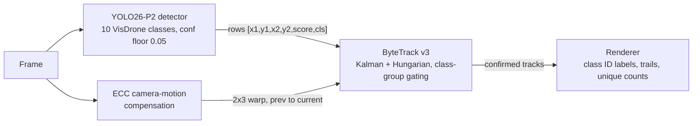
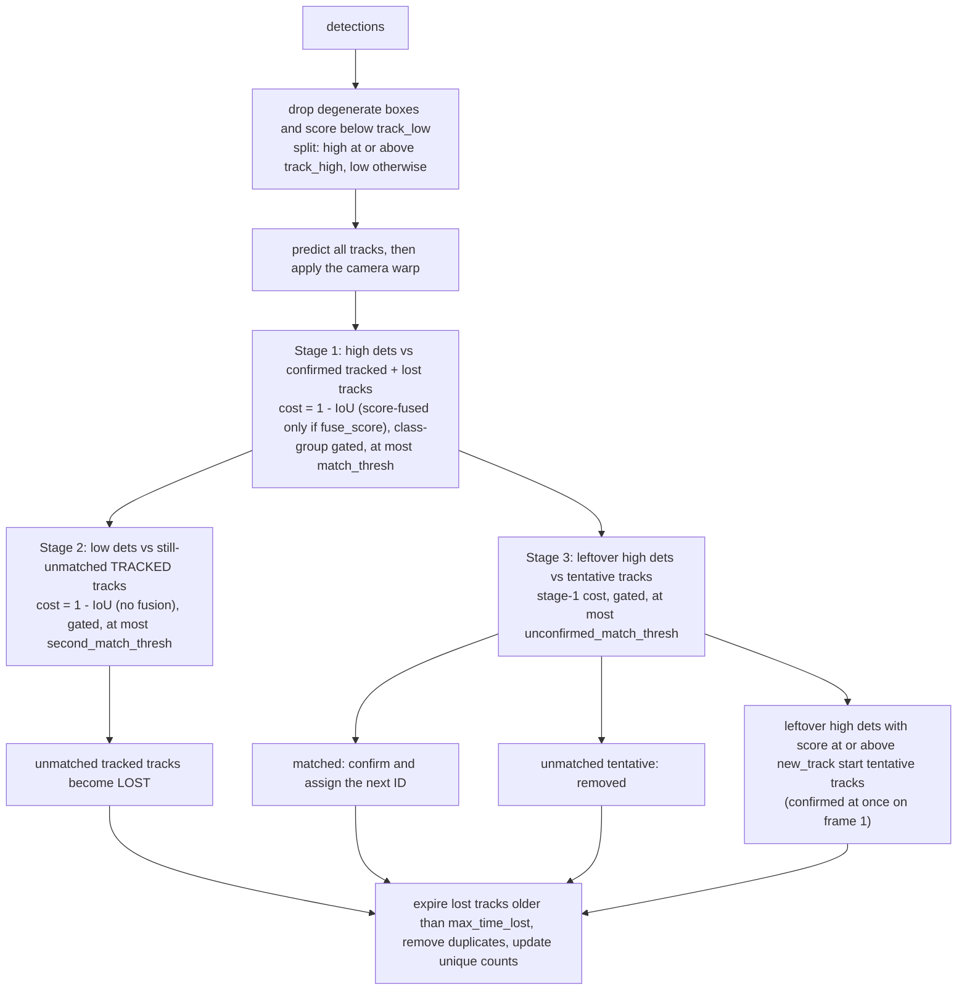

# Architecture

This document describes how The Aerial Guardian works and why it is built the way it is:
the data pipeline, the detector, the from-scratch tracker, camera-motion compensation, the
evaluation protocol, the browser port, and the problems I ran into along the way. It describes the code as it
is on this branch; where a number is quoted it is either a constant in the code (linked) or a
measurement, and the way it was measured is stated. Accuracy numbers (mAP, HOTA) for the retrained models are
not repeated here: see [README, Results](../README.md#results).

Contents: [1 Overview](#1-system-overview) · [2 Data](#2-data) · [3 Detector](#3-detector) ·
[4 Tracker](#4-tracker) · [5 Camera motion](#5-camera-motion-compensation) ·
[6 Evaluation](#6-evaluation-protocol) · [7 Browser port](#7-browser-port) ·
[8 Lessons learned](#8-lessons-learned)

---

## 1. System overview

### 1.1 Pipeline

The detector and the motion estimator read the same frame independently. Their outputs meet in
`ByteTracker.update(dets, warp)`, which is the only interface between them
([src/tracker/byte_tracker.py](../src/tracker/byte_tracker.py)). The detection array contract is the same in
Python and JavaScript: one row per box, `[x1, y1, x2, y2, score, cls]`, in original-image pixels.

### 1.2 Two runtimes

| | Python pipeline | Browser demo |
|---|---|---|
| Purpose | Evaluation, tuning, quality renders | Free, serverless, interactive demo |
| Detector | YOLO26s-P2 at 1280 px (`.pt`, fp16 on CUDA), one-to-many head plus NMS (IoU 0.6) | YOLO26n-P2 at 960 px (ONNX, ONNX Runtime Web, WebGPU then WASM), one-to-one NMS-free head |
| Camera motion | OpenCV ECC, Euclidean model, 3-level pyramid | Translation-only SAD search on a 160 px thumbnail |
| Tracker | [src/tracker/](../src/tracker/) | [web/js/tracker.js](../web/js/tracker.js), a port checked against fixtures produced by the Python tracker |
| Entry point | [scripts/03_track.py](../scripts/03_track.py), [scripts/05_eval_mot.py](../scripts/05_eval_mot.py) | [web/index.html](../web/index.html), [web/js/app.js](../web/js/app.js) |

The two runtimes share the confidence floor (0.05), the ten classes and one tracker specification. They do **not**
run the same detection head: the Python pipeline loads the checkpoint with its one-to-many head and applies NMS, while
the browser model is exported from the one-to-one head, which needs no NMS (3.2, 3.7). The README's tracking numbers come
from [src/pipeline.py](../src/pipeline.py), the code path that renders the videos, and describe the one-to-many plus NMS
path; the browser's one-to-one path is checked for export fidelity (3.7) but not scored separately.

### 1.3 Repository map

| Directory | Contents |
|---|---|
| [src/](../src/) | `data/` (VisDrone parsing, masking, label lines), `tracker/` (Kalman filter, matching, ByteTrack v3, ECC), `eval/` (MOTChallenge conversion, TrackEval wrapper, person recall/precision, v1 ONNX decoder), `utils/` (classes, renderer, video I/O), `pipeline.py` (detector wrapper, `run_tracking`, caching) |
| [scripts/](../scripts/) | Numbered entry points (download, dataset build, track, detector eval, MOT eval and tuning, web export); `dev/` holds the golden-fixture generator |
| [kaggle/](../kaggle/) | Training notebook source, notebook builder, code upload, helpers (time budget, path resolution) |
| [configs/](../configs/) | `tracker.yaml`, all tracker thresholds |
| [web/](../web/) | `js/` (inference, tracker, kalman, matching, hungarian, cmc, frameGate, render, stats, app), `tests/` (`node --test`, including parity against the Python tracker), `model/` |
| [tests/](../tests/) | pytest suite (CPU only, no dataset downloads) and fixtures |

---

## 2. Data

### 2.1 Splits and their roles

| Split | Size | Used for |
|---|---|---|
| VisDrone2019-DET-train | 6,471 images | Training |
| VisDrone2019-MOT-train | 56 sequences, every 5th frame | Training |
| VisDrone2019-DET-val | 548 images (38,759 boxes in the 10-class conversion; 13,969 pedestrian + people) | Detector validation (mAP, person recall) |
| VisDrone2019-MOT-val | 7 sequences | Tracker threshold tuning, nothing else |
| VisDrone2019-MOT-test-dev | 17 sequences | The reported tracking numbers |

The 33-sequence test-challenge split has no public ground truth and is not used. Consecutive video frames are
near-duplicates, so [scripts/01_build_dataset.py](../scripts/01_build_dataset.py) keeps frames
`(frame_id - 1) % 5 == 0` of each MOT-train sequence (`--mot-stride`) and adds all of DET-train for scene diversity.
The tracker is never tuned on test-dev, and the detector is never trained on DET-val or MOT-test-dev.

Only the evaluation splits live on the development laptop
([scripts/00_download_data.py](../scripts/00_download_data.py)); the training splits are downloaded inside the
Kaggle notebook. The MOT data comes from a public Kaggle dataset of about 34k extracted files rather than zips, so the
script downloads the archive once, extracts only the requested folders, and deletes it.

### 2.2 Class map

VisDrone categories 1-10 map to YOLO indices 0-9 in [src/data/visdrone.py](../src/data/visdrone.py): 0 pedestrian,
1 people, 2 bicycle, 3 car, 4 van, 5 truck, 6 tricycle, 7 awning-tricycle, 8 bus, 9 motor. The tracker gates on four
groups, defined once in [src/utils/classes.py](../src/utils/classes.py) and mirrored in
[web/js/classes.js](../web/js/classes.js): person {0, 1}, vehicle {3, 4, 5, 8}, two-wheeler {2, 9}, tricycle {6, 7}.

### 2.3 Ignored regions and why masking matters

VisDrone marks areas that annotators did not label as category 0 (ignored region) or 11 ("others"); in DET files a
`score` of 0 also means "ignore". The first version of this project dropped the class "people" (category 2) with nothing
covering those pixels and left ignored regions as they were in the training image, so real objects were shown to the
detector as background. The builder keeps all ten classes, and in the training split fills every ignore box with grey
`(114, 114, 114)` (`MASK_VALUE`, the value Ultralytics uses for letterbox padding) so the network sees "no information"
rather than "no object". Masking is applied to the train split only; val stays untouched so mAP remains comparable with
published VisDrone numbers. Other conversion rules, all in [src/data/visdrone.py](../src/data/visdrone.py):

- Boxes are clipped to the image and dropped if either side is below 2 px afterwards; ignore boxes and categories outside
  the class map produce no label line.
- Images without an ignore region are hardlinked (copy fallback); a masked image is re-encoded as JPEG quality 95. The
  destination is unlinked before writing, because an earlier version wrote through a hardlink and overwrote the raw source
  image on a re-run.
- `--limit N` caps the samples per source directory (the Kaggle smoke run uses it); `--person-only` builds a
  single-class variant used to score the old person-only model.

---

## 3. Detector

### 3.1 Why a P2 head

A detector predicts on grids whose cell size is the feature stride. The default YOLO heads use strides 8, 16 and
32. A pedestrian that is 8 px wide covers about one cell of the stride-8 grid, so the network has exactly one
location from which to localise it. The P2 variant adds a stride-4 level fed by the shallow, high-resolution
backbone features (the `Concat` with backbone layer 2 in `yolo26-p2.yaml`). At `imgsz` 960 that grid has 240 x 240
cells, and in the exported browser model it shows in the output size: a raw head has
240² + 120² + 60² + 30² = 76,500 anchors, of which the P2 level contributes 57,600 (without it there would be 18,900).
An object of 8 px now covers 2 x 2 cells, and a 16 px object 4 x 4. Small objects like these are what this level is for.

The price is four times as many anchors plus a high-resolution head, which is why model and input size are chosen per
runtime (3.4) and why training memory is a constraint (3.5).

### 3.2 Why YOLO26

I use Ultralytics 8.4.174 (pinned in [requirements.txt](../requirements.txt); the configs `yolo26n-p2.yaml` and
`yolo26s-p2.yaml` are referenced by name and not copied into the repo). What the installed package shows
(paths are relative to the `ultralytics` package):

- **No DFL.** `cfg/models/26/yolo26-p2.yaml` sets `reg_max: 1`, and the `Detect` head only builds a DFL layer when
  `reg_max > 1` (`nn/modules/head.py`). Box regression is a direct distance prediction, which keeps the exported graph simpler.
- **End-to-end head.** The yaml sets `end2end: True`. The head has a one-to-many branch and a one-to-one branch that
  selects its top-K rows directly, so inference through that branch needs no NMS (3.7). `E2ELoss` in `utils/loss.py` trains
  both: it weights the one-to-many loss by 0.8 at the start and decays it to 0.1, so the NMS-free branch is progressively favoured.
- **Small-box-aware assignment.** In the task-aligned assigner (`utils/tal.py`), a ground-truth box with a side
  smaller than `stride_val` is enlarged to that size when positive anchor centres are selected, so tiny objects keep
  candidate anchors. `stride_val` is the second-level stride, 8 px for a P2 model (strides 4, 8, 16, 32).
- **Which head runs where.** The checkpoint loads in Python with `end2end` disabled, so `predict` uses the one-to-many
  head followed by NMS. The browser export switches to the one-to-one head (3.7). Python-side mAP and tracking numbers
  therefore describe the one-to-many plus NMS path.

I do not claim anything beyond this about YOLO26 internals. The P2 level and the pretrained weights were chosen from
the design rationale above; I did not run an ablation that isolates either. The README compares the old model and the
new one as a whole, not each change separately.

### 3.3 Pretrained weights and the transfer check

The first version of this project most likely trained from scratch by mistake. With Ultralytics 8.0.x, my reading of the training
code was that `YOLO("model.yaml").train(pretrained=True)` loads no weights: `Model.train()` hands weights to the
trainer only when the model was created from a `.pt` file. The run logged no error, converged to something
detector-shaped, and produced an mAP50 of 0.196. I have not re-checked this on 8.4.174; the notebook no longer depends
on the answer.

[kaggle/train_notebook.py](../kaggle/train_notebook.py) now builds the architecture from the P2 yaml
(`YOLO("yolo26{SCALE}-p2.yaml")`), snapshots its state dict, loads the regular checkpoint with `model.load(...)`, and
asserts that every tensor of backbone layers 0-10 differs from its random initialisation; otherwise the notebook stops
before spending any GPU hours. The head is only partly transferred (the P2 branch and the 10-class output
layers have no counterpart in the 80-class donor), which is expected. `train()` is also given
`pretrained="yolo26{SCALE}.pt"` so the trainer's own rebuilt model loads the weights too. On the Kaggle smoke run (n scale)
the check printed `backbone 200/200` tensors and Ultralytics' own log read "Transferred 360/902 items from pretrained
weights", two independent confirmations. The check asserts the backbone only, and tensors that are identical across
initialisations (some normalisation statistics) cannot prove a transfer, which is why the trainer's own "Transferred
N/M items" line is also read in every smoke run.

### 3.4 Two model sizes

| | n-P2, browser | s-P2, offline renders and evaluation |
|---|---|---|
| Input size | 960 | 1280 |
| Batch per step / effective batch | 16 / 64 (accumulate 4) | 4 / 64 (accumulate 16) |
| Size (10-class model, Ultralytics summary at its 640 px reference) | 2.52 M parameters, 7.7 GFLOPs | 9.67 M parameters, 26.7 GFLOPs |

The sizes are the model summaries printed in the Kaggle training logs before layer fusion; the GFLOPs figure is for the
640 px reference and grows with the input area, so the 960 and 1280 px models cost more per frame than it suggests.
n at 960 is sized to run in a browser tab; s at 1280 is the quality reference for rendered videos and for the tracking
evaluation. Both come from the same notebook, selected by `SCALE` ([kaggle/build_notebook.py](../kaggle/build_notebook.py) `--scale`).

### 3.5 Training budget and memory

Kaggle kills a session at 12 hours. [kaggle/train_notebook.py](../kaggle/train_notebook.py) therefore never asks for
a fixed epoch count. It passes `time=` to Ultralytics, which recomputes the total epoch count after the first epochs so
that the cosine learning-rate schedule completes inside the budget (`epochs=300` is only an upper bound). `time=` only
bounds training; setup (pip install, downloads, dataset build) happens before it, so `compute_time_budget` in
[kaggle/notebook_helpers.py](../kaggle/notebook_helpers.py) subtracts it:
`min(TIME_HOURS, SESSION_LIMIT_H - setup_hours_already_spent - RESERVE_H)` with 9.5 h requested, an 11.0 h session limit
and 1.0 h reserved for the final validation, checkpoint copy and plots; it refuses to start if under 0.5 h remain.

Memory on a Kaggle T4 (about 15 GB usable) is the binding constraint for the s model. The first full run at 1280 px and
batch 8 hit a CUDA out-of-memory error on dense scenes (the log showed a batch whose largest image held 198
ground-truth objects). Ultralytics' built-in retry ("Reducing to batch=4 and retrying") then failed with `CUDA error:
unknown error`; I did not investigate why, but an in-process retry after the OOM did not recover. The notebook now
starts at batch 4 and uses Ultralytics' nominal batch size (`nbs=64`) to accumulate gradients to an effective
batch of 64 (`accumulate = round(64 / 4) = 16`), and sets `PYTORCH_CUDA_ALLOC_CONF=expandable_segments:True` before
torch is imported. The lesson was to size the first epoch for the worst-case dense image rather than the average one.
Other settings: cosine LR, `close_mosaic=10`, `flipud=0`, `fliplr=0.5`, `scale=0.5`, HSV jitter, `seed=42`, `save_period=5`.

### 3.6 Detector confidence is low on purpose

Everything downstream is built around a detector confidence floor of 0.05
(`DetectorSettings.conf` in [src/pipeline.py](../src/pipeline.py), `DETECTOR_CONF` in
[web/js/app.js](../web/js/app.js)). ByteTrack's second association stage exists to keep tracks alive on weak
detections (an occluded or blurred object scores low), and those boxes must reach the tracker to be used. High-precision
thresholds are applied by the tracker (`track_high`, `new_track`), not by the detector. The same floor is given to
the Ultralytics baselines in the evaluation so the comparison is fair.

Other Python-side settings: NMS IoU 0.6 (`DetectorSettings.iou`, passed to `predict`; it applies to the one-to-many head
the checkpoint loads with), `max_det=1000` because dense frames exceed Ultralytics' default of 300, and fp16 on CUDA.
[scripts/04_eval_det.py](../scripts/04_eval_det.py) calls `val` and `predict` without an `iou` argument, so it uses
Ultralytics' default NMS IoU. The browser runs no NMS on its exported model: the one-to-one head returns its own top-K
rows (3.7), and `RAW_NMS_IOU = 0.6` in `app.js` applies only if a raw-layout model is loaded.

### 3.7 Export for the browser

[scripts/06_export_web.py](../scripts/06_export_web.py) exports static-shape ONNX (opset 17, simplified by
`onnxslim`) and writes `model-meta.json` (input size, output format, class names, source weights, Ultralytics version).

- **`nms=False` is required for the NMS-free layout.** In 8.4.174 the exporter switches the head to its one-to-one
  branch only when `nms` is exactly `False`; the default (`None`) exports the raw head. The result is `[1, 300, 6]`
  rows of `(x1, y1, x2, y2, score, cls)` in letterboxed input pixels, 300 being the exporter's top-K. A raw export is
  `[1, 4 + nc, N]` and needs NMS in the browser; the script detects which one it produced from the output shape and
  cross-checks the `end2end` entry in the ONNX metadata.
- **The parity check compares matching heads.** ONNX Runtime and the PyTorch weights are run on real images and
  compared. For `end2end`, the PyTorch side must also use the one-to-one head (`predict(nms=False)`); a freshly loaded
  checkpoint predicts with its one-to-many head plus NMS, which would report differences on a perfectly good export. Rows
  are matched by class, score (tolerance 1e-4) and box (0.5 px) rather than by position, because near-tied scores reorder
  between runtimes, and `rect=False` is used on both sides because the ONNX model and the browser use the full square.
  Because both sides use the one-to-one head, the check verifies the export, not the accuracy of that head.
- **Failures are loud.** The export aborts if the requested and detected layouts differ, if `onnxslim` is missing
  (Ultralytics would otherwise silently write an unsimplified graph), or if weights named `smoke` or `dev` are
  pointed at the committed `web/model/` directory.

---

## 4. Tracker

The tracker is a ByteTrack variant written from scratch (no Ultralytics or filterpy code):
[kalman_filter.py](../src/tracker/kalman_filter.py), [matching.py](../src/tracker/matching.py),
[byte_tracker.py](../src/tracker/byte_tracker.py). Its dependencies are numpy and scipy.

### 4.1 Motion model

State: `[cx, cy, a, h, vx, vy, va, vh]` with `a = w / h`, measurement `[cx, cy, a, h]`, constant-velocity
transition with `dt` = 1 frame. All position and velocity noise scales with the box height
(`std_weight_position = 1/20`, `std_weight_velocity = 1/160`): initial position standard deviation `h / 10` for
(cx, cy, h), initial velocity `h / 16`, process noise `h / 20` (position) and `h / 160` (velocity), measurement noise
`h / 20`; the aspect terms are fixed (`1e-2` state, `1e-1` measurement, `1e-5` velocity).

The first version used fixed pixel noise (Q = 1 px, R = 1 px or 10 px), which is too loose for an 8 px
pedestrian and far too tight for a 200 px bus. With height scaling a 40 px tall object starts with a 4 px position
standard deviation, and the same filter behaves the same at any altitude. Lost tracks have their height velocity
zeroed before prediction so a box does not shrink or grow while unobserved. Detections with non-positive width or
height are dropped on input, since `h <= 0` makes the innovation covariance singular.

### 4.2 Per-frame algorithm

Implemented in `ByteTracker.update` ([byte_tracker.py](../src/tracker/byte_tracker.py)). Points that are easy to miss:

- Stage 1 is a single Hungarian assignment (`scipy.optimize.linear_sum_assignment`) over the joint pool of tracked and
  lost tracks, as in the reference ByteTrack, so lost tracks compete directly with tracked ones. The cost is `1 - IoU`,
  optionally fused with the score (`1 - IoU * score`, when `fuse_score` is true; the tuned configuration turns it off); a
  pair is accepted when cost <= `match_thresh`.
- Stage 2 offers low-score detections (`track_low <= score < track_high`) only to tracks that are still tracked, with
  plain `1 - IoU <= second_match_thresh` (IoU >= 0.5). A weak box is enough to keep a visible track alive, not to resurrect a
  lost one. Tracked tracks that find nothing become lost.
- Duplicate removal and counting follow expiry (4.5); every track is moved by the camera warp after prediction (5.4).

### 4.3 Tentative tracks and when IDs exist

A new track has no ID and is not returned to the caller. It must be matched on the very next frame by a *high*
detection (stage 3) to become confirmed, and only then does the instance counter issue the next integer. A
one-frame false positive therefore never appears on screen and never burns an ID, so IDs stay dense. On frame 1 every
new track is confirmed immediately, since there is nothing earlier to match against. The ID counter belongs to the
`ByteTracker` instance, so independent trackers (and test runs) never share state.

### 4.4 Class-group gating and the displayed class

Association cost is set to `1e6` (`GATED_COST`: finite so that scipy has a feasible matrix, far above every
threshold) whenever a track and a detection belong to different class groups, so a person can never take over a car's
ID. Inside a group the displayed class of a track is the majority of its last `class_vote_window` (30) matched
classes, ties going to the most recent class. A pedestrian that the detector alternates between "pedestrian" and
"people" keeps one ID and a stable label instead of flickering or splitting into two tracks.

### 4.5 Duplicate removal and unique counting

After each frame, tracked and lost tracks of the same group whose boxes overlap with IoU > 0.85 are duplicates (a
lost track that was re-detected as a new track at the same place); the older track survives. Counting uses
`min_hits_for_count` (3): a confirmed track counts toward its group's unique total once it has been matched on three
frames (`hits` includes the frame that created it), and each track ID is counted exactly once. The HUD reports these
unique totals (objects seen so far), not the number visible right now.

### 4.6 Frame-rate scaling of `max_time_lost`

`max_time_lost` is specified in frames at 30 fps and scaled by the source rate:
`int(round(max_time_lost * frame_rate / 30))`. Python's `round` is round-half-to-even, so 15 frames at 25 fps
is `round(12.5) = 12`, not 13. JavaScript's `Math.round` rounds halves up, so the JS port has its own `pyRound`
([web/js/tracker.js](../web/js/tracker.js)) and the parity fixtures include a 25 fps scenario that pins it.

### 4.7 Worked example

Three frames, default configuration (the values in `configs/tracker.yaml`, 4.8), boxes `[x1, y1, x2, y2]`. These are the
tracker's actual outputs on this input.

| Frame | Detections | What happens |
|---|---|---|
| 1 | car `[100,100,160,140]` 0.90; pedestrian `[300,200,312,230]` 0.60; pedestrian `[500,100,520,140]` 0.30 | The car and the 0.60 pedestrian reach `new_track` (0.6; the test is `>=`) and are confirmed immediately as IDs 1 and 2. The 0.30 box is a low detection with no track to match: discarded. |
| 2 | car `[104,100,164,140]` 0.90; "people" `[300,201,312,231]` 0.30; pedestrian `[400,400,420,430]` 0.60 | Stage 1: the car matches ID 1 (IoU with the prediction 0.875, cost `1 - IoU` = 0.125 <= 0.7) and the Kalman state moves 3.5 px (not 4): the filter blends prediction and measurement. The 0.30 box is low, so stage 2 matches it to ID 2 (IoU 0.94) and the class votes become `[pedestrian, people]`, a tie, so the most recent, "people", is shown. The 0.60 box at `[400,400,...]` has no match: it becomes a tentative track and is not drawn. |
| 3 | car `[108,100,168,140]` 0.85; pedestrian `[300,202,312,232]` 0.55; pedestrian `[401,400,421,430]` 0.60 | The car and the pedestrian match in stage 1 (ID 2's votes are now `[pedestrian, people, pedestrian]`, so the label returns to "pedestrian" with the same ID). The `[401,400,...]` box is matched by stage 3 to the tentative track, which is confirmed as ID 3 (consecutive: no ID was spent on the unmatched 0.30 box). Tracks 1 and 2 now have three hits and are counted: `{person: 1, vehicle: 1}`; track 3 has two hits. |

### 4.8 Configuration

[configs/tracker.yaml](../configs/tracker.yaml) holds every threshold, loaded by `TrackerConfig.from_yaml`
(unknown keys raise). The values are tuned on MOT-val only (6.5) and are the ones behind the reported tracking numbers
([README, Results](../README.md#results)). The `TrackerConfig` dataclass defaults are the same values, so `ByteTracker()`
without a config behaves like the file; a pytest pins the two together, and the JavaScript `DEFAULT_CONFIG` in
[web/js/tracker.js](../web/js/tracker.js) is pinned to the file by the parity fixtures (7.1).

| Key | Default | Meaning |
|---|---|---|
| `track_high` | 0.4 | Detections at or above this are "high": stage 1, and may start tracks |
| `track_low` | 0.1 | Detections below this are discarded; `[track_low, track_high)` feed stage 2 |
| `new_track` | 0.6 | Minimum score to start a tentative track |
| `match_thresh` | 0.7 | Stage-1 cost threshold: accepted when `1 - IoU <= 0.7`, i.e. IoU >= 0.3 |
| `second_match_thresh` | 0.5 | Stage-2 cost threshold for low boxes (IoU >= 0.5) |
| `unconfirmed_match_thresh` | 0.7 | Stage-3 cost threshold for tentative tracks |
| `max_time_lost` | 30 | Frames a lost track survives, at 30 fps; scaled by the source frame rate |
| `fuse_score` | false | If true, multiply IoU similarity by the detection score in stages 1 and 3 |
| `class_vote_window` | 30 | Matched detections that vote for the displayed class |
| `min_hits_for_count` | 3 | Matches before a track enters the unique totals |

`match_thresh` is a *cost* threshold. Its value 0.7 corresponds to a minimum IoU of 0.3, not 0.7; reading it as
an IoU threshold was an early bug (8.2). Only `track_high`, `new_track`, `max_time_lost`, `match_thresh` and
`fuse_score` are in the tuning grid (6.5). The tuned `new_track` (0.6) is the top of its grid range, and the best variants
were within a few hundredths of a HOTA point of each other, so these values are a reasonable choice rather than a sharp
optimum.

---

## 5. Camera-motion compensation

### 5.1 Why

A drone camera moves. When it pans or yaws, every object's image position shifts by the same amount even if the
objects stand still, and the shift can be larger than the object. For a 10 px pedestrian a 5 px shift between frames
takes IoU with the previous box from 1 to about 0.33, so association by IoU becomes brittle in exactly the
footage this project targets. The Kalman filter models each object's own motion; it cannot know that the whole frame
slid. Estimating the camera motion separately and moving all predicted boxes with it restores overlap.

### 5.2 Estimating the motion

[src/tracker/ecc_compensator.py](../src/tracker/ecc_compensator.py) estimates the transform between consecutive
frames with OpenCV's enhanced correlation coefficient (ECC) maximisation, `cv2.findTransformECC`. The frame is
downscaled to 320 px wide with the **aspect ratio preserved** (`dh = round(fh * 320 / fw)`, `INTER_AREA`) and converted to
grey; the motion model is Euclidean (rotation + translation), 30 iterations, 1e-4 tolerance.

A **three-level pyramid** (`levels=3`, stopping early if a side falls below 32 px) solves the coarsest level first
and refines. Single-scale ECC on the 320 px image only converges when the motion is within about one texture wavelength;
on fine-grained texture (grass, gravel seen from above) it either diverges or locks onto a wrong optimum. A failure
at a finer level keeps the coarser estimate; a failure at the coarsest level (flat sky, heavy blur) returns the
identity, meaning "no camera motion". On 100 synthetic noise-texture trials (five frame sizes and shifts, 20 seeds), three
levels recovered the shift within 1 px in 98 (79 with two levels, 31 with four, which is too coarse for noise-like
texture); the misses degrade to the identity. The returned 2 x 3 matrix maps previous-frame pixels to current-frame pixels
(`findTransformECC(template=prev, input=curr)` returns template-to-input, so no inversion is needed); the first frame, and
any change of frame size, returns the identity.

### 5.3 Rescaling the warp: S M S⁻¹

ECC runs on the downscaled image, but boxes live in full-frame pixels. If the small image is `1/sx` and `1/sy` the size
of the frame (`S = diag(sx, sy, 1)`), a point is mapped into the small image by `S⁻¹`, moved by the small-image warp `M`,
and mapped back by `S`, so the full-frame warp is `M_full = S · M_small · S⁻¹`. `ECCCompensator.rescale_warp` computes
this literally (a unit test compares it with the three-step route, for an anisotropic `sx != sy`). The first version
resized every frame to a fixed 320 x 180 and scaled only the translation column: correct on 16:9 frames, wrong elsewhere,
because the squashed image distorts a rotation and `S R S⁻¹ != R` when `sx != sy` (8.2). Now the aspect ratio is preserved
when downscaling, so `sx` and `sy` differ only by the rounding of `dh`; the exact form also serves the pyramid, where
each level is lifted by `S = diag(2, 2, 1)`.

### 5.4 Applying the warp to the Kalman state

`STrack.apply_warp` moves both the estimate and its uncertainty. With `R` the 2 x 2 part and `t` the translation of the
warp, define the 8 x 8 matrix `T` that holds `R` at `[0:2, 0:2]` (position) and at `[4:6, 4:6]` (velocity) and the
identity elsewhere; then `mean <- T · mean` followed by `mean[0:2] += t`, and `covariance <- T · covariance · Tᵀ`. Position
is rotated and translated; velocity is only rotated (a camera translation does not change how fast an object moves in the
image, but a rotation turns its velocity vector); aspect and height are untouched, which is right for a Euclidean model.
The warp is applied after the Kalman prediction and before association, to confirmed, lost and tentative tracks alike.

### 5.5 Measured cost

Per frame on CPU, with the pyramid, ECC took roughly 6-11 ms depending on resolution and machine. This is a quick
measurement on MOT-val frames at 720p and 1080p on the development machine, not a committed benchmark, and the
repository has no script for it. One caveat: when ECC fails to converge it returns the identity after only a few
milliseconds, so timing frames where it fails understates the cost. At 30 fps the budget is 33 ms per frame, so ECC is
affordable next to the detector. Whether it improves tracking on real VisDrone footage is measured by the "Ours (no camera-motion
comp.)" and "Ours + ECC" rows of the evaluation table ([README, Results](../README.md#results)), not asserted here.

### 5.6 The browser estimator

The browser does not ship OpenCV (about 8 MB for one function). [web/js/cmc.js](../web/js/cmc.js) estimates a global
**integer translation** by brute-force sum-of-absolute-differences on a grayscale thumbnail 160 px wide
(`GlobalMotion`), over a window of +-8 thumbnail pixels (`estimateShift`, `radius = 8`), sampling every second pixel. It
returns `[[1, 0, dx * s], [0, 1, dy * s]]` with `s = srcW / 160`. What it can and cannot do:

- It handles panning, the dominant motion; it cannot represent rotation, scale or perspective.
- Shifts are quantised to whole thumbnail pixels, i.e. `srcW / 160` source pixels (8 px on a 1280 px frame), and shifts
  beyond +-8 thumbnail pixels (+-64 px at 1280) are not recovered: the estimate saturates at the window edge or falls back to zero.
- **Noise gate.** The best of ~289 candidate shifts beats the zero shift by a few percent even on pure noise, so the
  best mean SAD must be below `0.9 *` the zero-shift SAD (`gate = 0.9`), otherwise it returns `[0, 0]`: a static camera
  or a low-texture frame reports no motion rather than a confident random shift that would be added to every track.
- A small penalty (`1e-3 * (dx² + dy²)`) breaks ties toward small motion. The first frame and the frame after any reset or
  source change return `null` (no warp). The demo toggle disables it, and it is never used for a still image.

---

## 6. Evaluation protocol

### 6.1 Detector metrics

[scripts/04_eval_det.py](../scripts/04_eval_det.py) evaluates on VisDrone2019-DET-val:

1. **Ultralytics validation** (`model.val(imgsz, batch=4, max_det=1000)`): mAP50, mAP50-95 and per-class AP50
   over the ten classes (the one-to-many head with NMS, 3.6).
2. **The old-vs-new yardstick.** The v1 model has a single "person" class and the new one has ten, so their mAPs are
   not comparable. Both are scored the same way: person predictions at confidence 0.25 are greedily matched
   (score-ordered, one-to-one) to pedestrian + people ground truth at IoU 0.5
   ([src/eval/det_metrics.py](../src/eval/det_metrics.py)), reporting recall and precision. Predictions mostly
   (IoA > 0.5) inside an ignored region are dropped. The old model is run at 960, its native size, through Ultralytics'
   own ONNX path; an independent decoder written to match the old web client
   ([src/eval/onnx_person.py](../src/eval/onnx_person.py)) cross-checks it (see 8.1). For the 10-class model one
   physical person can produce both a "pedestrian" and a "people" prediction, so its precision is slightly pessimistic.

### 6.2 Tracking metrics

[scripts/05_eval_mot.py](../scripts/05_eval_mot.py) writes ground truth and predictions in MOTChallenge format and runs
TrackEval (HOTA, CLEAR MOTA, Identity IDF1, plus ID switches) through
[src/eval/trackeval_runner.py](../src/eval/trackeval_runner.py). The tables report the pooled sequence-combined
numbers (so long and crowded sequences weigh more), and a second per-sequence table shows HOTA per sequence. Two
groups are scored, each as its own TrackEval benchmark: **person** (ground truth pedestrian (1) + people (2) against the
person tracker group) and **vehicle** (car (4) + van (5) + truck (6) + bus (9) against the vehicle group; these are VisDrone category
ids, the web code's class indices for the same group are 3, 4, 5, 8). Two-wheelers
and tricycles are tracked and drawn but not scored. VisDrone's per-box truncation and occlusion flags are deliberately not
used to filter ground truth, and TrackEval runs with `DO_PREPROC=False` (its preprocessing only removes distractor
classes, and each group file has a single class).

### 6.3 Ignored regions: both sides

Ground-truth boxes inside ignored regions (IoA > 0.5) and predictions inside them are both discarded
([src/eval/mot_format.py](../src/eval/mot_format.py)). Filtering predictions alone looks sufficient but is not: ground-truth
boxes in an ignore region would still be counted as missed objects, so even a perfect tracker could not
reach 100 (8.3). With the symmetric filter, feeding the ground truth back in as predictions scores exactly 100 on every
metric, which is the sanity ceiling I test against. A sequence with no ground truth of a group (for example one
without vehicles) shows `n/a` in the per-sequence table instead of TrackEval's meaningless 0.0.

### 6.4 Baselines

All variants share the same detections: Ultralytics ByteTrack with its default config (`model.track(...,
tracker="bytetrack.yaml")`); Ultralytics ByteTrack with my thresholds (`track_high`, `track_low`, `new_track`,
`track_buffer`, `match_thresh`, `fuse_score` written from `configs/tracker.yaml`); `ByteTracker` with `warp = None`; and
`ByteTracker` with the ECC warps. The second row exists because the default Ultralytics config uses different
thresholds, so "mine versus Ultralytics" would otherwise confound the tracker code with the thresholds. With the same
thresholds, the remaining difference is the tracker implementation (tentative tracks, class gating and votes, duplicate
removal, camera motion). Detector settings are identical across rows: same weights, `imgsz`, `conf=0.05`, NMS IoU 0.6,
`max_det=1000`, fp16 on CUDA. Ultralytics' stage-2 (0.5) and unconfirmed (0.7) thresholds are fixed in its code and equal
mine, and its association does not gate by class; I leave the baseline as shipped. (Ultralytics' low-score test is
`score > track_low`; mine is `>=`.)

### 6.5 Tuning

`python scripts/05_eval_mot.py --tune` grid-searches on **MOT-val only** and the script refuses any `--split` whose
directory name contains "test" (an accident guard, not a security boundary). The grid is `track_high` in {0.3, 0.4, 0.5},
`new_track` in {0.4, 0.5, 0.6}, `max_time_lost` in {30, 60}, `match_thresh` in {0.7, 0.8, 0.9} and `fuse_score` in
{true, false}: 108 combinations, minus the 12 with `new_track < track_high` (they behave exactly like
`new_track == track_high`, because only detections above `track_high` can start tracks), i.e. 96 variants, each scored by
the mean of person and vehicle HOTA with ECC on. The winner is written to `outputs/eval/mot_tune/tuning.md` and copied into
`configs/tracker.yaml` by hand, after which the JavaScript defaults and the golden fixtures are regenerated (7.1).
`track_low`, `second_match_thresh`, `unconfirmed_match_thresh`, the vote window and `min_hits_for_count` are fixed.

### 6.6 Caching

The detector and ECC are by far the slowest steps, and tracker variants only change association. `cache_sequence` runs
them once per sequence and stores detections and warps in `outputs/cache/`; `track_cached` replays them through any
`ByteTracker` in milliseconds, so a sweep costs TrackEval time rather than GPU time (roughly 4 s per variant per
group). The cache key contains the weights file (name, size, mtime), `imgsz`, confidence, NMS IoU, `max_det`, a manual
`CACHE_VERSION`, the split name and the frame limit, so retrained weights or a changed ECC never read a stale cache. A
unit test checks that replaying the cache equals running live.

---

## 7. Browser port

### 7.1 Keeping the JavaScript tracker faithful

[web/js/tracker.js](../web/js/tracker.js), [kalman.js](../web/js/kalman.js), [matching.js](../web/js/matching.js) and
[hungarian.js](../web/js/hungarian.js) reproduce the Python tracker with no numerical library. Equal code is not
assumed; it is tested. [scripts/dev/make_tracker_golden.py](../scripts/dev/make_tracker_golden.py) runs the real Python tracker
on seeded synthetic scenes and writes two fixtures that record the detections, warps and resulting tracks frame by frame:
[tracker_golden.json](../tests/fixtures/tracker_golden.json) (one 50-frame scene with six objects, an occlusion, a low-score
run, class flicker and a one-frame false positive) and [tracker_parity.json](../tests/fixtures/tracker_parity.json) (ten
compact scenarios built to reach every branch that scene misses, such as tentative confirm and removal, expiry at the
frame-rate-scaled boundary at 25 and 30 fps, rotating and missing warps, vote trimming, cross-group duplicates and three
random crowds with junk detections). The generator counts tracker events while it runs and raises if a scenario stops
exercising its branch.

`node --test` in `web/` replays both fixtures through the JavaScript tracker and requires identical track IDs, classes, box
coordinates (1e-6), tracked and lost counts, unique counts and total IDs
([parity.test.mjs](../web/tests/parity.test.mjs), [tracker.test.mjs](../web/tests/tracker.test.mjs)).
[tests/test_tracker_golden.py](../tests/test_tracker_golden.py) regenerates the fixtures from the current Python tracker
and `configs/tracker.yaml` and fails with a "stale" message if the committed files differ, so changing the Python
tracker without regenerating makes the Python suite fail instead of letting the demo drift. Details that needed explicit
care: round-half-even (4.6), the row-sorted order of assignment matches (so IDs are issued in the same order), the
degenerate-box filter, and vote ties (most recent class wins).

### 7.2 Decoding

[web/js/inference.js](../web/js/inference.js) reads `web/model/model-meta.json` (validated: integer input size, layout of
`end2end` or `raw`, ten class names) and decodes whichever layout the export produced: `end2end` `[1, K, 6]` rows with
score >= confidence are taken directly, with no NMS; `raw` `[1, 4 + nc, N]` takes the best class per anchor, a
confidence filter, the top 3,000 candidates (to bound the quadratic NMS over the 76,500-anchor layout) and a class-aware
greedy NMS at IoU 0.6. Preprocessing is a letterbox into a square canvas with 114 grey padding (the same fill as
Ultralytics), RGB, scaled to 0-1, channel-first in one reusable float buffer; boxes are mapped back to source pixels and clipped.

### 7.3 Frame gating

An animation-frame loop runs at the display rate, not the video rate, so a 30 fps clip on a 60 Hz screen is processed
about twice per frame. In a headless Chrome test, where animation frames are not throttled to a real display, up to 78% of
detector calls were duplicates (671 calls for 149 distinct presented frames); at a real 60 Hz display roughly half
would be. Duplicates inflate `hits`, shorten `max_time_lost` in wall-clock terms and feed the Kalman filter zero-motion
measurements. [web/js/frameGate.js](../web/js/frameGate.js) decides whether a presented frame is new:

- It uses `requestVideoFrameCallback` and its `mediaTime` / `presentedFrames`. `video.currentTime` cannot be
  used: in Chrome it is interpolated and advances on every animation frame, so a gate on it saw no duplicates at all
  while a gate on `mediaTime` found 522 in the same run. Without that callback it falls back to
  `getVideoPlaybackQuality().totalVideoFrames`, then to a ~30 fps wall-clock throttle. Webcam streams use the
  presented-frame counter only, since their media time is not a reliable clock.
- A decrease of the media time (a looping clip restarting, or a seek back) is a **wrap**: the tracker, the motion
  estimator and the counters reset, because carrying tracks across a restart would add the same objects again on every loop.
- While an inference is in flight further frames are skipped, so a slow device processes every Nth frame rather than queueing.

### 7.4 Frame-rate-aware `max_time_lost`

If inference is slower than the video, consecutive processed frames are several video frames apart and a fixed
`max_time_lost` would expire tracks in too little real time. `ProcessingRate` keeps an exponential average of the
processed frame rate, and `ByteTracker.setFrameRate` rescales `max_time_lost` from it (floor of 3 frames); the UI shows a
hint when frames are more than 1.5 video frames apart. This scaling from the measured processing rate exists only in the
browser: it is not in the golden fixtures (they pin only the scaling from the source frame rate, 4.6) and is covered by
[web/tests/tracker-rate.test.mjs](../web/tests/tracker-rate.test.mjs). The Kalman filter still assumes `dt = 1` per
processed frame, so a heavily skipped stream gets coarser motion prediction.

### 7.5 Overlay, backends and the confidence slider

The overlay canvas has the video's pixel size but is displayed scaled; line width, font and trail width are computed from
`canvas.width / clientWidth` ([web/js/render.js](../web/js/render.js) `overlayMetrics`) so that boxes stay about 2 CSS px and
labels about 12 CSS px on a phone and on a 4K clip alike. Inference tries the `webgpu` execution provider and falls back to
`wasm` ([web/js/inference.js](../web/js/inference.js)), with `wasm.numThreads = 1` so the page works on static hosts without
the cross-origin-isolation headers that multi-threading needs. The confidence slider only changes the tracker's `new_track`;
the detector always runs at 0.05.

### 7.6 Limitations

- The browser CMC is translation-only and quantised (5.6), and the ECC used for reported numbers is not available in the page.
- The browser runs the one-to-one NMS-free head, while every Python-side mAP and tracking number describes the one-to-many
  head plus NMS (3.2, 3.6). The one-to-one path is verified for export fidelity (3.7) but not scored separately.
- The exported model returns at most K = 300 rows per frame; the Python pipeline uses `max_det=1000`, so extremely
  dense scenes are capped in the browser. The n-P2 model at 960 px is also weaker than the s-P2 model at 1280 px used for
  the offline renders and the evaluation tables; browser frame rates depend on the device and backend and have not
  been benchmarked; the page shows a live FPS meter.
- The end-to-end graph was only seen to create a WebGPU session in headless Chrome on one machine, numerical agreement
  between the WebGPU and WASM backends was not tested, and the WASM fallback was run in Node rather than in a browser; the page
  falls back automatically if the WebGPU session cannot be created.
- The Kalman filter assumes one step per processed frame (7.4), and the webcam path is covered by unit tests but not
  by an automated browser test. Everything is tuned on VisDrone; other altitudes, sensors and scenes were not measured.

---

## 8. Lessons learned

### 8.1 The detector was (probably) trained from scratch

The original README reported mAP50 0.196, recall 14.5% and precision 62.7% for the person-only YOLOv8n-P2 model, on
a small split drawn from six VisDrone sequences (1,978 train and 275 validation frames, all from the MOT-val split).
Those numbers were plausible for a small model on a small dataset, which is why nothing looked broken. Reading the
Ultralytics 8.0.236 training code indicated that `YOLO(model.yaml).train(pretrained=True)` loads no weights (3.3).

Scored on the full VisDrone2019-DET-val with this repository's own evaluation (person recall and precision at confidence
0.25, IoU 0.5, ignore regions respected, 548 images, 13,969 person ground-truth boxes), the old model recovers only
**2.8%** of persons (391 true positives) at **55.7%** precision (702 predictions). An independent decoder that
reimplements the old web client's pipeline agrees on recall (2.78%) and gives 60.3% precision; the difference is the NMS IoU
(Ultralytics' 0.7 versus the old client's 0.45). The 14.5% had been measured on a tiny slice that resembled the training
data. The fixes (pretrained weights, a dataset more than five times larger, the "people" class, ignore masking, a larger
model) were applied together, and the README compares the old and new models as a whole.

### 8.2 Threshold semantics and the anisotropic rescale

Two bugs that a happy-path test could not reveal. The very first tracker compared the IoU itself with `match_thresh`
(a cost threshold, 4.8), demanding 80% overlap, so nearly every association was rejected. The first compensator was
correct on 16:9 frames and wrong on any other aspect ratio (5.3), which a 16:9 test video can never show. The fixes came
with tests off the happy path (a non-16:9 frame, rescale versus the three-step route for `sx != sy`). The lessons: write
down which side of a threshold is "good" where the number lives ([src/tracker/matching.py](../src/tracker/matching.py)
does so in its docstring), and test on shapes the demo video does not have.

### 8.3 Evaluation pitfalls

- **Prediction-only ignore filtering caps a perfect tracker** (6.3). My first protocol dropped predictions inside ignored
  regions but kept ground-truth boxes that lay in them. Feeding the ground truth back in as predictions scored 98.8 HOTA
  (person) and 99.7 (vehicle) on MOT-val instead of 100: 808 of 50,312 person and 132 of 40,286 vehicle ground-truth
  boxes lie in ignore regions. With symmetric filtering the same experiment scores exactly 100 on both.
- **Smaller traps.** Zero-ground-truth groups printed 0.0 even for a perfect tracker (the table now prints `n/a`);
  default-config baselines confound tracker code with thresholds (6.4); tuning must never touch the test split (6.5).

### 8.4 Kaggle lessons

- **The dataset mount layout changes.** My first notebook looked for `/kaggle/input/<slug>`; datasets were mounted at
  `/kaggle/input/datasets/<owner>/<slug>`. The notebook now searches the input tree breadth-first for a marker file
  (`find_input_dir`, bounded in depth so it never walks the 34k files of the MOT dataset). A wrong MOT path used to
  degrade to a silent DET-only run; it now raises, and DET-only requires the explicit `--no-mot`.
- **A notebook built by script needs a kernelspec.** `jupytext` writes no notebook metadata, and Kaggle's runner then fails with
  "No kernel name found in notebook"; `build_notebook.py` writes the kernelspec itself. Memory and time budgets: see 3.5.

### 8.5 The oracle experiment

To separate tracker problems from detector problems I fed the ground-truth boxes (score 0.9) of the first two MOT-val
sequences into the tracker, with identity warps (no camera-motion compensation), and scored the result with the same
TrackEval pipeline. This was a scratch experiment run through the repository's functions, not a committed script, so the
numbers are about association, not the detector. With perfect boxes the pipeline scores 82.7 HOTA (person) and 91.4
(vehicle) on a 2 x 60-frame slice, and about 80.0 HOTA with 186 ID switches on 2 x 120 frames; all 77 person ID switches of
the first slice come from one crowded sequence. Feeding the ground truth directly as the tracker output scores 100 with zero
switches, so the evaluation itself is sound. Varying thresholds changed the switch count only moderately (`match_thresh` 0.9
gave 145, `fuse_score=false` 166, `max_time_lost` 60 gave 196, `match_thresh` 0.7 gave 272; `track_high` and `new_track` were
irrelevant with oracle scores).

Two conclusions, one partly a hypothesis. First, the detector was the larger problem: with perfect detections the
tracker scores 97.5 HOTA (person) on the uncrowded sequence and above 80 pooled on the slice, while the old detector found
2.8% of persons. The tracker is not solved, though: crowds of tiny boxes still produce many ID switches (77 on one sequence).
Second, because the camera moves, 10 px boxes lose overlap between frames (5.1) and thresholds only partly compensate;
that motion is the likely main cause of those switches, which motivated the ECC stage, but I did not repeat the oracle run
with real ECC warps. The ECC benefit is measured on detector output by the "Ours (no camera-motion comp.)" and "Ours + ECC" rows
of the report ([README, Results](../README.md#results)).
